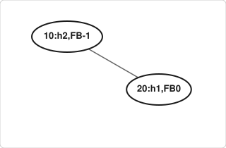
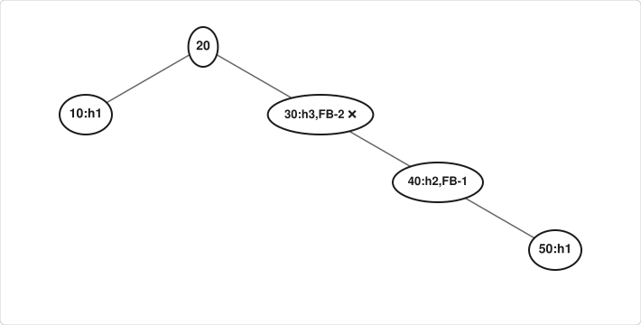
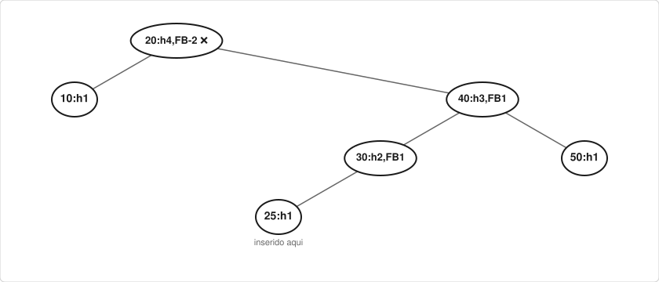
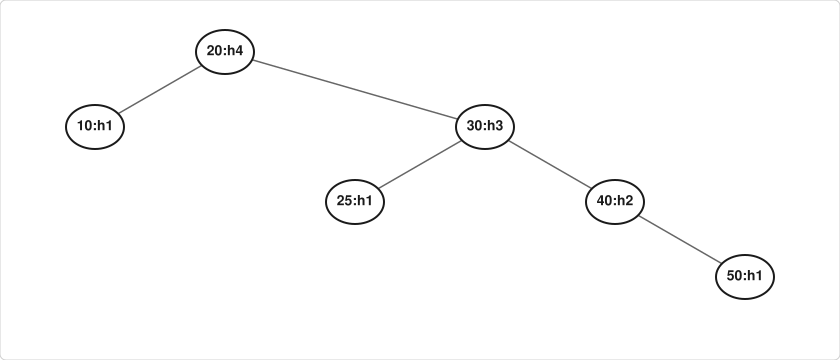
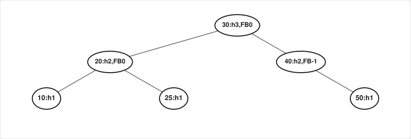

# AVL - Implementação

## 1. Revisão Rápida: Por Que Implementar AVL?

---

No capítulo anterior, vimos que:

| Situação | ABB Comum | AVL |
| --- | --- | --- |
| Inserção ordenada `[1,2,3,4,5]` | Degenera → O(n) | Balanceada → O(log n) |
| Fator de balanceamento | Não verifica | Verifica automaticamente (`\|FB\| ≤ 1`) |
| Rebalanceamento | Não faz | Rotações automáticas |

!!! question "Ideia central da implementação"
    Vamos **partir do código da ABB** (capítulo de Árvores Binárias de Busca) e modificá-lo. A cada inserção, devemos:

    1. Inserir como em uma ABB normal (o `inserir` que já conhecemos)
    2. **Atualizar a altura** dos nós ancestrais
    3. **Verificar o FB** e aplicar rotação se necessário

### 1.1 O Que Muda em Relação à ABB?

| Elemento | ABB (capítulo anterior) | AVL (este capítulo) |
| --- | --- | --- |
| Estrutura `No` | `valor`, `esquerda`, `direita` | **+ campo `altura`** |
| `criarNo` | Inicializa os ponteiros | **+ `altura = 0`** (folha) |
| `altura(No*)` | Calculada recursivamente: **O(n)** | Lida do campo: **O(1)** |
| `inserir` | Insere como folha | **+ atualiza altura, calcula FB e rotaciona** |
| Funções novas | — | `fatorBalanceamento`, `rotacaoDireita`, `rotacaoEsquerda` |
| `buscar`, `emOrdem`, `contarNos`, `liberarABB` | — | **Não mudam** |

!!! note "Mesma convenção de altura"
    Usamos a mesma convenção do capítulo anterior: **folha tem altura 0** e **árvore vazia (`NULL`) tem altura -1**.

---

## 2. Estrutura de Dados: O Nó AVL

A única diferença para o nó da ABB é o campo `altura`:

```c
#include <stdio.h>
#include <stdlib.h>

// Nó da AVL: igual ao da ABB, mais o campo altura
typedef struct No {
    int valor;              // Chave de busca
    int altura;             // NOVO: altura do nó (essencial para o balanceamento!)
    struct No* esquerda;    // Subárvore à esquerda
    struct No* direita;     // Subárvore à direita
} No;
```

!!! tip "Por que armazenar a altura?"
    - No capítulo anterior, `altura()` percorria a árvore inteira: **O(n)**
    - Se a chamássemos a cada verificação de balanceamento, a inserção deixaria de ser O(log n)
    - Armazenando o valor no nó, atualizamos em O(1) durante a subida da recursão
    - Trade-off: +4 bytes por nó vs. eficiência garantida

---

## 3. Funções Auxiliares Fundamentais

### 3.1 Obter Altura com Segurança

Mantemos o **mesmo nome** `altura`, agora com custo O(1):

```c
// Retorna a altura de um nó (folha = 0), ou -1 se for NULL (árvore vazia)
int altura(No* raiz) {
    if (raiz == NULL)
        return -1;          // Mesma convenção do capítulo anterior
    return raiz->altura;    // Lê o campo, sem percorrer a árvore
}
```

!!! warning "Importante"
    Esta função protege contra acesso a ponteiro `NULL`. Sempre use `altura(no)` em vez de `no->altura` diretamente.

### 3.2 Função `max` Simples

No capítulo anterior usamos o operador ternário dentro de `altura`. Como agora vamos repetir essa comparação várias vezes, vale isolá-la:

```c
// Retorna o maior entre dois inteiros
int max(int a, int b) {
    return (a > b) ? a : b;
}
```

### 3.3 Criar Novo Nó

É o `criarNo` da ABB com uma linha a mais:

```c
// Cria um novo nó com o valor informado
No* criarNo(int valor) {
    No* novo = (No*) malloc(sizeof(No));
    if (novo == NULL) {
        fprintf(stderr, "Erro: falha ao alocar memória\n");
        exit(EXIT_FAILURE);
    }
    novo->valor = valor;
    novo->esquerda = NULL;
    novo->direita = NULL;
    novo->altura = 0;       // NOVO: todo nó inserido é folha → altura = 0
    return novo;
}
```

!!! success "Boas práticas"
    - Sempre verificar retorno de `malloc`
    - Inicializar todos os campos, especialmente `altura = 0`

### 3.4 Atualizar a Altura de um Nó

Esta fórmula será usada na inserção e nas rotações, então vamos dar um nome a ela:

```c
// Recalcula a altura de um nó a partir das alturas dos filhos
void atualizarAltura(No* raiz) {
    raiz->altura = 1 + max(altura(raiz->esquerda), altura(raiz->direita));
}
```

Verificando com uma folha: `1 + max(-1, -1) = 0` ✓. Por isso `altura(NULL) = -1` é a convenção que faz a fórmula funcionar sem tratar a folha como caso especial.

### 3.5 Calcular Fator de Balanceamento

```c
// FB = altura(esquerda) - altura(direita)
int fatorBalanceamento(No* raiz) {
    if (raiz == NULL)
        return 0;
    return altura(raiz->esquerda) - altura(raiz->direita);
}
```

| Valor do FB | Interpretação |
| --- | --- |
| `> +1` | Subárvore esquerda mais alta → possível rotação à direita |
| `< -1` | Subárvore direita mais alta → possível rotação à esquerda |
| `-1, 0, +1` | Nó balanceado ✓ |

---

## 4. Rotações: Implementação Passo a Passo

### 4.1 Rotação Simples à Direita (Caso LL)

**Situação visual:**

**Antes (FB = +2, caso LL):**


**Depois:**


Nas figuras, `z` é o nó desbalanceado e `y` o filho que sobe. No código abaixo, o nó desbalanceado recebe o nome `y` e o filho que sobe, `x`; `T2` é a subárvore que muda de pai (a `T3` da figura).

**Implementação:**

```c
// Rotação simples à direita em torno de y
No* rotacaoDireita(No* y) {
    No* x = y->esquerda;      // x é filho esquerdo de y
    No* T2 = x->direita;      // T2 é subárvore direita de x

    // Executa rotação
    x->direita = y;           // y vira filho direito de x
    y->esquerda = T2;         // T2 vira filho esquerdo de y

    // Atualiza alturas (primeiro y, depois x)
    atualizarAltura(y);
    atualizarAltura(x);

    // Retorna nova raiz da subárvore
    return x;
}
```

!!! note "Ordem de atualização"
    Sempre atualize o nó que "desceu" primeiro (y), depois o que "subiu" (x): a altura de x depende da altura de y.

### 4.2 Rotação Simples à Esquerda (Caso RR)

**Situação visual:**

**Antes (FB = -2, caso RR):**


**Depois:**


**Implementação:**

```c
// Rotação simples à esquerda em torno de x
No* rotacaoEsquerda(No* x) {
    No* y = x->direita;       // y é filho direito de x
    No* T2 = y->esquerda;     // T2 é subárvore esquerda de y

    // Executa rotação
    y->esquerda = x;          // x vira filho esquerdo de y
    x->direita = T2;          // T2 vira filho direito de x

    // Atualiza alturas (primeiro x, depois y)
    atualizarAltura(x);
    atualizarAltura(y);

    return y;                 // Nova raiz da subárvore
}
```

---

## 5. Inserção AVL: Da ABB para a AVL

### 5.1 Ponto de Partida: O `inserir` da ABB

Este é o código do capítulo anterior:

```c
No* inserir(No* raiz, int valor) {
    if (raiz == NULL) return criarNo(valor);
    if (valor < raiz->valor)
        raiz->esquerda = inserir(raiz->esquerda, valor);
    else if (valor > raiz->valor)
        raiz->direita = inserir(raiz->direita, valor);
    return raiz;
}
```

Ele já tem a propriedade que precisamos: **retorna a raiz da subárvore**. Isso permite que, depois de uma rotação, o nível acima receba o novo topo.

### 5.2 Versão AVL

Tudo o que está **antes** do `// NOVO` continua igual:

```c
No* inserir(No* raiz, int valor) {
    // ===== PASSO 1: Inserção padrão de ABB (código anterior) =====
    if (raiz == NULL)
        return criarNo(valor);

    if (valor < raiz->valor)
        raiz->esquerda = inserir(raiz->esquerda, valor);
    else if (valor > raiz->valor)
        raiz->direita = inserir(raiz->direita, valor);
    else
        return raiz;  // Valor duplicado: não insere

    // ===== PASSO 2 (NOVO): Atualizar altura do nó atual =====
    atualizarAltura(raiz);

    // ===== PASSO 3 (NOVO): Calcular o fator de balanceamento =====
    int fb = fatorBalanceamento(raiz);

    // ===== PASSO 4 (NOVO): Rebalancear se necessário (4 casos) =====

    // Caso LL: FB > 1 e valor inserido na esquerda da esquerda
    if (fb > 1 && valor < raiz->esquerda->valor)
        return rotacaoDireita(raiz);

    // Caso RR: FB < -1 e valor inserido na direita da direita
    if (fb < -1 && valor > raiz->direita->valor)
        return rotacaoEsquerda(raiz);

    // Caso LR: FB > 1 e valor inserido na direita da esquerda
    if (fb > 1 && valor > raiz->esquerda->valor) {
        raiz->esquerda = rotacaoEsquerda(raiz->esquerda);
        return rotacaoDireita(raiz);
    }

    // Caso RL: FB < -1 e valor inserido na esquerda da direita
    if (fb < -1 && valor < raiz->direita->valor) {
        raiz->direita = rotacaoDireita(raiz->direita);
        return rotacaoEsquerda(raiz);
    }

    // ===== PASSO 5: Retorna a raiz (possivelmente após rotação) =====
    return raiz;
}
```

### 5.3 Por Que Atualizar a Altura **Antes** de Verificar o FB?

```
❌ ERRADO:
1. Inserir nó
2. Calcular FB com alturas desatualizadas
3. → Decisão de rotação baseada em dados incorretos!

✅ CORRETO:
1. Inserir nó (recursivamente)
2. Atualizar altura do nó atual: altura = 1 + max(esq, dir)
3. Calcular FB com alturas corretas
4. Decidir rotação com base em FB preciso
```

!!! tip "Analogia"
    É como medir a temperatura antes de decidir se liga o ar-condicionado. Medir depois não faz sentido!

### 5.4 Por Que a Função Retorna `No*`?

```c
raiz->esquerda = inserir(raiz->esquerda, valor);  // ← Atribuição importante!
```

- Após uma rotação, a **raiz da subárvore muda**
- O retorno da função é o **novo topo** da subárvore balanceada
- A atribuição `raiz->esquerda = ...` ou `raiz->direita = ...` reconecta a árvore corretamente

**Antes da rotação:**


**Após rotação em B:**


Sem a atribuição: `A->esquerda` ainda apontaria para B (antigo, agora filho). Com a atribuição: `A->esquerda = C` (novo topo) ✓

---

## 6. Funções de Apoio para Depuração

### 6.1 Percurso Em-Ordem (Validação de Ordenação)

Idêntico ao da ABB, não muda nada:

```c
// Em-ordem: deve imprimir valores crescentes em uma ABB/AVL
void emOrdem(No* raiz) {
    if (raiz != NULL) {
        emOrdem(raiz->esquerda);
        printf("%d ", raiz->valor);
        emOrdem(raiz->direita);
    }
}
```

### 6.2 Impressão Visual da Árvore (Debug)

É o `imprimirABB` do capítulo anterior, agora mostrando também a altura e o FB de cada nó:

```c
// Imprime a AVL "deitada" (rotação de 90°), no formato [valor:altura,FB]
void imprimirABB(No* raiz, int nivel) {
    if (raiz == NULL) return;

    // Imprime subárvore direita primeiro (para visualização deitada)
    imprimirABB(raiz->direita, nivel + 1);

    // Imprime identação, valor, altura e FB
    for (int i = 0; i < nivel; i++) printf("    ");
    printf("[%d:h%d,FB%d]\n", raiz->valor, raiz->altura, fatorBalanceamento(raiz));

    // Imprime subárvore esquerda
    imprimirABB(raiz->esquerda, nivel + 1);
}
```

**Exemplo de saída:**

```
Inserindo [10, 20, 30]:

    [30:h0,FB0]
[20:h1,FB0]
    [10:h0,FB0]

Interpretação:
- Raiz é 20 (altura 1, balanceada)
- 10 e 30 são folhas (altura 0)
```

### 6.3 Liberar Memória (Boa Prática)

Também idêntico ao da ABB:

```c
// Libera toda a memória (pós-ordem)
void liberarABB(No* raiz) {
    if (raiz != NULL) {
        liberarABB(raiz->esquerda);
        liberarABB(raiz->direita);
        free(raiz);
    }
}
```

---

## 7. Código Completo Compilável

```c
#include <stdio.h>
#include <stdlib.h>

// ===== Estrutura do nó (ABB + campo altura) =====
typedef struct No {
    int valor;
    int altura;
    struct No* esquerda;
    struct No* direita;
} No;

// ===== Funções auxiliares =====
No* criarNo(int valor) {
    No* novo = (No*) malloc(sizeof(No));
    if (!novo) { fprintf(stderr, "Erro de alocação\n"); exit(1); }
    novo->valor = valor;
    novo->esquerda = novo->direita = NULL;
    novo->altura = 0;                  // folha = 0
    return novo;
}

int max(int a, int b) {
    return (a > b) ? a : b;
}

int altura(No* raiz) {
    return (raiz == NULL) ? -1 : raiz->altura;   // vazio = -1
}

void atualizarAltura(No* raiz) {
    raiz->altura = 1 + max(altura(raiz->esquerda), altura(raiz->direita));
}

int fatorBalanceamento(No* raiz) {
    return (raiz == NULL) ? 0 : altura(raiz->esquerda) - altura(raiz->direita);
}

// ===== Rotações =====
No* rotacaoDireita(No* y) {
    No* x = y->esquerda;
    No* T2 = x->direita;

    x->direita = y;
    y->esquerda = T2;

    atualizarAltura(y);
    atualizarAltura(x);

    return x;
}

No* rotacaoEsquerda(No* x) {
    No* y = x->direita;
    No* T2 = y->esquerda;

    y->esquerda = x;
    x->direita = T2;

    atualizarAltura(x);
    atualizarAltura(y);

    return y;
}

// ===== Inserção AVL =====
No* inserir(No* raiz, int valor) {
    // 1. Inserção ABB padrão
    if (!raiz) return criarNo(valor);

    if (valor < raiz->valor)
        raiz->esquerda = inserir(raiz->esquerda, valor);
    else if (valor > raiz->valor)
        raiz->direita = inserir(raiz->direita, valor);
    else
        return raiz;  // duplicata

    // 2. Atualiza altura
    atualizarAltura(raiz);

    // 3. Calcula FB
    int fb = fatorBalanceamento(raiz);

    // 4. Rebalanceamento (4 casos)
    // LL
    if (fb > 1 && valor < raiz->esquerda->valor)
        return rotacaoDireita(raiz);
    // RR
    if (fb < -1 && valor > raiz->direita->valor)
        return rotacaoEsquerda(raiz);
    // LR
    if (fb > 1 && valor > raiz->esquerda->valor) {
        raiz->esquerda = rotacaoEsquerda(raiz->esquerda);
        return rotacaoDireita(raiz);
    }
    // RL
    if (fb < -1 && valor < raiz->direita->valor) {
        raiz->direita = rotacaoDireita(raiz->direita);
        return rotacaoEsquerda(raiz);
    }

    return raiz;
}

// ===== Utilitários (iguais aos da ABB) =====
void emOrdem(No* raiz) {
    if (raiz) {
        emOrdem(raiz->esquerda);
        printf("%d ", raiz->valor);
        emOrdem(raiz->direita);
    }
}

void imprimirABB(No* raiz, int nivel) {
    if (!raiz) return;
    imprimirABB(raiz->direita, nivel + 1);
    for (int i = 0; i < nivel; i++) printf("    ");
    printf("[%d:h%d,FB%d]\n", raiz->valor, raiz->altura, fatorBalanceamento(raiz));
    imprimirABB(raiz->esquerda, nivel + 1);
}

void liberarABB(No* raiz) {
    if (raiz) {
        liberarABB(raiz->esquerda);
        liberarABB(raiz->direita);
        free(raiz);
    }
}

// ===== Main: Exemplo passo a passo =====
int main() {
    No* raiz = NULL;
    int valores[] = {10, 20, 30, 40, 50, 25};
    int n = sizeof(valores) / sizeof(valores[0]);

    printf("=== Inserção AVL passo a passo ===\n\n");

    for (int i = 0; i < n; i++) {
        printf("Inserindo %d:\n", valores[i]);
        raiz = inserir(raiz, valores[i]);
        imprimirABB(raiz, 0);
        printf("\n");
    }

    printf("Percurso em-ordem (deve sair ordenado): ");
    emOrdem(raiz);
    printf("\n\n");

    printf("Estatísticas finais:\n");
    printf("  Altura da raiz: %d\n", altura(raiz));
    printf("  FB da raiz: %d\n", fatorBalanceamento(raiz));

    liberarABB(raiz);
    return 0;
}
```

---

## 8. Execução Passo a Passo: Exemplo `[10, 20, 30, 40, 50, 25]`

### Inserção 10

`[10:h0,FB0]` → Árvore com 1 nó, balanceada ✓

### Inserção 20



→ FB(10) = -1 - 0 = -1 ✓ (dentro de [-1,1])

### Inserção 30 → **Desbalanceamento RR!**

**Antes da rotação:**


FB(10) = -1 - 1 = -2 → caso RR.

**Após rotação esquerda em 10:**


→ Balanceada! ✓

### Inserção 40


→ FB(20) = 0 - 1 = -1 ✓, FB(30) = -1 - 0 = -1 ✓

### Inserção 50 → **Desbalanceamento RR em 30!**

**Antes:**



Na volta da recursão, o primeiro ancestral desbalanceado é 30, e ele é rotacionado antes que a altura de 20 seja recalculada (por isso 20 aparece sem rótulo).

**Rotação esquerda em 30:**


→ Balanceada! ✓

### Inserção 25 → **Desbalanceamento RL em 20!**

**Antes:**



O 25 desce por 20 → 40 → 30 e entra como filho esquerdo de 30. Os nós 30 e 40 continuam com |FB| ≤ 1, mas FB(20) = 0 - 2 = -2.

Caminho: 20 → Direita(40) → Esquerda(30) → Caso RL (no código: `fb < -1` e `25 < raiz->direita->valor`, que é 40)

**Passo 1: Rotação direita em 40:**



**Passo 2: Rotação esquerda em 20:**



→ Balanceada! ✓

### Saída Final

```
Percurso em-ordem: 10 20 25 30 40 50  ← Ordenado! ✓

Estatísticas:
  Altura da raiz: 2
  FB da raiz: 0
```

!!! success "Verificação no VisuAlgo"
    Acesse [https://visualgo.net/en/bst](https://visualgo.net/en/bst), selecione "AVL", insira `[10,20,30,40,50,25]` e compare com nossa execução.

---

## 9. Exercícios para Fixação (Com Código)

### Exercício 1 — Validação de Ordenação

Modifique o `main()` para inserir os valores `[5, 3, 7, 1, 4, 6, 8]` e verifique:

a) O percurso em-ordem imprime os valores em ordem crescente?

b) Todos os nós têm `|FB| ≤ 1`?

c) Qual a altura final da árvore?

<details>
<summary>Gabarito esperado</summary>

```
a) Saída em-ordem: 1 3 4 5 6 7 8 ✓
b) Sim, todos os FB ∈ {-1, 0, 1} (nenhuma rotação é necessária)
c) altura(raiz) = 2 (árvore cheia com 7 nós, ⌊log₂ 7⌋ = 2)
```

</details>

### Exercício 2 — Inserção Ordenada (Caso Crítico)

Insira `[1, 2, 3, 4, 5, 6, 7]` em ordem crescente.

a) Quantas rotações ocorrem durante as inserções?

b) Qual a altura final da AVL?

c) Compare com a altura que uma ABB comum teria com a mesma sequência.

<details>
<summary>Resposta</summary>

```
a) Rotações (todas simples à esquerda, caso RR):
   - Após inserir 3: rotação em 1
   - Após inserir 5: rotação em 3
   - Após inserir 6: rotação em 2 (a raiz)
   - Após inserir 7: rotação em 5
   Total: 4 rotações simples. Árvore final: 4(2(1,3), 6(5,7))

b) altura(raiz) = 2

c) ABB comum degenerada: altura 6
   Busca no pior caso: 7 comparações na ABB vs 3 na AVL
```

</details>

### Exercício 3 — Função de Busca AVL

A busca da AVL é **exatamente a mesma** da ABB. Reescreva a versão iterativa do capítulo anterior para a AVL, sem consultar o texto:

```c
No* buscarIterativo(No* raiz, int chave);
```

Teste buscando valores presentes e ausentes na árvore do Exercício 1. Por que a busca não precisa de nenhuma modificação?

<details>
<summary>Esboço de solução</summary>

```c
No* buscarIterativo(No* raiz, int chave) {
    No* atual = raiz;

    while (atual != NULL) {
        if (chave == atual->valor)
            return atual;
        else if (chave < atual->valor)
            atual = atual->esquerda;
        else
            atual = atual->direita;
    }
    return NULL;  // não encontrado
}
```

A busca só **lê** a árvore e a AVL continua sendo uma ABB. O que muda é a garantia de que a altura `h` fica próxima de log₂(n).

</details>

### Exercício 4 — Desafio: Contar Rotações

Adicione um contador global para contar quantas rotações foram executadas durante uma sequência de inserções:

```c
static int contadorRotacoes = 0;

// Dentro de cada caso de rotação na função inserir():
contadorRotacoes++;
```

Teste com sequências:

- Aleatória: `[42, 17, 89, 5, 33, 71]`
- Ordenada: `[1, 2, 3, 4, 5, 6]`
- Inversa: `[6, 5, 4, 3, 2, 1]`

Qual sequência exige mais rotações? Por quê?

---

## 10. Discussão: Por Que a Altura é Essencial na Inserção?

### Cenário Hipotético: E Se Não Atualizássemos a Altura?

```c
// ❌ VERSÃO COM ERRO (não atualiza altura):
No* inserirErrado(No* raiz, int valor) {
    if (raiz == NULL) return criarNo(valor);

    if (valor < raiz->valor)
        raiz->esquerda = inserirErrado(raiz->esquerda, valor);
    else if (valor > raiz->valor)
        raiz->direita = inserirErrado(raiz->direita, valor);

    // ❌ Altura não atualizada!
    // int fb = fatorBalanceamento(raiz);  ← FB calculado com dados velhos!

    return raiz;
}
```

**Consequências:**

1. O FB calculado será **incorreto** (baseado em alturas desatualizadas)
2. Rotações podem ser aplicadas **no momento errado** ou **não aplicadas quando necessário**
3. A árvore pode **permanecer desbalanceada** → perda da garantia O(log n)
4. Em casos extremos, pode causar **loop infinito** ou **corrupção de estrutura**

### Por Que Atualizar na Subida da Recursão?

```
Inserção é recursiva: inserir(raiz, valor)
1. Desce até encontrar posição de folha (caso base)
2. Cria novo nó
3. **Sobe** a pilha de chamadas, atualizando cada ancestral
4. Em cada nível, verifica FB e rotaciona se necessário

A altura só pode ser calculada APÓS as subárvores estarem prontas!
```

!!! tip "Analogia da construção"
    Você não pode medir a altura de um prédio enquanto ainda está construindo o andar de cima. Primeiro termina os andares superiores, depois mede de baixo para cima.

---

## 11. Resumo do Capítulo

**Da ABB para a AVL:** o código da ABB é reaproveitado; acrescentamos o campo `altura` e três passos na inserção.

**Convenção de altura:** igual à do capítulo anterior (folha = 0, `NULL` = -1).

**Estrutura do nó AVL:** campo `altura` é obrigatório para eficiência (`altura()` passa de O(n) para O(1))

**Funções auxiliares:** `altura()`, `max()`, `atualizarAltura()`, `fatorBalanceamento()`

**Rotações implementadas:**

- `rotacaoDireita()`: caso LL
- `rotacaoEsquerda()`: caso RR
- Casos LR/RL: composição das duas simples

**Inserção AVL:**

1. Inserir como ABB
2. Atualizar altura do nó atual
3. Calcular FB
4. Aplicar rotação conforme caso
5. Retornar nova raiz da subárvore

**Importância crítica:** Atualizar altura **antes** de calcular FB

**Retorno de ponteiro:** Necessário para reconectar subárvores após rotação

**Não mudam:** `buscar`, `emOrdem`, `contarNos` e `liberarABB`

**Validação:** Uso de `emOrdem()` e `imprimirABB()` para depuração

**Boas práticas:** Verificar `malloc`, liberar memória com `free()`

---

## 12. Próximos Passos & Ferramentas

**Para estudo complementar (fora do escopo deste livro):**

- Remoção em AVL: parte do `remover` da ABB e acrescenta atualização de altura e rebalanceamento em todos os ancestrais (mais complexa que inserção: pode exigir rotações em vários níveis)
- Árvores Rubro-Negras
- Comparação de desempenho: AVL vs. ABB vs. tabela hash

**Prática sugerida:**

1. **Compile e execute** o código completo da Seção 7
2. **Use o VisuAlgo** ([https://visualgo.net/en/bst](https://visualgo.net/en/bst)) para validar suas execuções
3. **Modifique o código** para imprimir uma mensagem quando uma rotação ocorrer, por exemplo no caso LL:

    ```c
    // Caso LL
    if (fb > 1 && valor < raiz->esquerda->valor) {
        printf("Rotação à direita em %d (caso LL)\n", raiz->valor);
        return rotacaoDireita(raiz);
    }
    ```

4. **Compare ABB e AVL:** insira `[1, 2, ..., 1000]` em ambas e compare a altura final (`altura()` recursiva da ABB vs. campo `altura` da AVL)

---

> **Dica para provas:** Ao simular a inserção AVL, recalcule altura e FB **de baixo para cima**, a partir do nó inserido. O primeiro ancestral com |FB| = 2 é o nó a ser rotacionado, e o caso (LL, RR, LR ou RL) é decidido pelo caminho da inserção a partir dele.

---

*Material elaborado para a disciplina de Estrutura de Dados — Curso de Engenharia de Computação*

*Prof. Sérgio Souza Costa | Atualizado: 2026*
