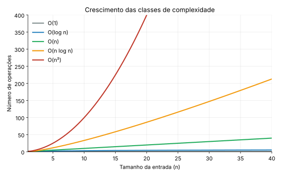

# Complexidade de Algoritmos & Análise de Desempenho (gcov, gprof e cppcheck)

**Disciplina:** Estrutura de Dados

Neste capítulo, estudaremos a **análise de algoritmos** sob duas perspectivas: a **teórica** (notação Big-O) e a **empírica** (medição de tempo, contagem de operações e ferramentas práticas de qualidade em C: `gcov`, `gprof` e `cppcheck`). Essas ferramentas ajudam a visualizar quais partes do código consomem mais tempo, quais caminhos não foram testados e quais erros o compilador não aponta.

!!! info "Conexão com o trabalho prático"
    Tudo o que aparece aqui é cobrado no **Trabalho Prático de Algoritmos de Ordenação**: a análise experimental (Seção 5), a cobertura (Seção 2), o profiling (Seção 3) e a análise estática (Seção 4). A Seção 7 mostra, ferramenta por ferramenta, onde cada conceito entra na entrega.

---

## 1. Análise Teórica: A Notação Big-O

A **complexidade de tempo** descreve a taxa de crescimento do tempo de execução de um algoritmo à medida que o tamanho da entrada (`n`) cresce. Usamos a notação **Big-O** para expressar um **limite superior** desse crescimento: dizemos que `f(n) = O(g(n))` se existem constantes `c > 0` e `n₀` tais que `f(n) ≤ c · g(n)` para todo `n ≥ n₀`.

Big-O é uma notação para **funções**, não para "casos": podemos falar do pior caso, do melhor caso ou do caso médio de um algoritmo, e cada um tem sua função de custo. Na prática, quando se diz apenas "o algoritmo é O(n²)", costuma-se referir ao pior caso.

Duas notações irmãs completam o quadro:

- **Ω(g(n))**: **limite inferior** (`f(n) ≥ c · g(n)` a partir de algum `n₀`).
- **Θ(g(n))**: a função é ao mesmo tempo O(g(n)) e Ω(g(n)), ou seja, cresce **exatamente** na ordem de `g(n)`.

### 1.1 Classes de Complexidade Comuns

| Notação | Nome | Exemplo prático | Comportamento |
| --- | --- | --- | --- |
| **O(1)** | Constante | Acesso a elemento de vetor por índice | O tempo não muda, independente do tamanho dos dados. |
| **O(log n)** | Logarítmico | Busca binária, inserção em Árvore AVL | O tamanho do problema é dividido pela metade a cada passo. Cresce muito devagar. |
| **O(n)** | Linear | Busca sequencial, percurso de lista encadeada | O tempo cresce proporcionalmente ao tamanho da entrada. |
| **O(n log n)** | Linearítmico | Merge Sort, Quick Sort (caso médio), Heap Sort | Complexidade típica de algoritmos eficientes de ordenação. |
| **O(n²)** | Quadrático | Bubble Sort, Selection Sort, Insertion Sort (pior caso) | Laços aninhados. Dobrar a entrada quadruplica o tempo. |

### 1.2 Comparação Visual do Crescimento



### 1.3 Melhor, Médio e Pior Caso nos Algoritmos de Ordenação

O mesmo algoritmo pode se comportar de forma diferente conforme a **entrada** (aleatória, já ordenada, invertida). A tabela resume os seis algoritmos do trabalho prático:

| Algoritmo | Melhor caso | Caso médio | Pior caso | Memória extra | Estável |
| --- | --- | --- | --- | --- | --- |
| **Bubble Sort** (versão simples) | O(n²) | O(n²) | O(n²) | O(1) | Sim |
| **Selection Sort** | O(n²) | O(n²) | O(n²) | O(1) | Não |
| **Insertion Sort** | **O(n)** | O(n²) | O(n²) | O(1) | Sim |
| **Merge Sort** | O(n log n) | O(n log n) | O(n log n) | O(n) | Sim |
| **Quick Sort** | O(n log n) | O(n log n) | **O(n²)** | O(log n)* | Não |
| **Heap Sort** | O(n log n) | O(n log n) | O(n log n) | O(1) | Não |

> *Pilha de recursão no caso médio. Com pivôs ruins, a pilha pode chegar a O(n).

!!! warning "Detalhes que costumam gerar dúvida"
    - **Bubble Sort simples** (sem parada antecipada, como no exemplo da Seção 6) faz **sempre** `n(n-1)/2` comparações, qualquer que seja a entrada. O que muda com a entrada é o número de **trocas**: 0 em um vetor crescente e `n(n-1)/2` em um decrescente. Só a versão com "parada antecipada" (para quando uma passada não troca nada) tem melhor caso O(n).
    - **Insertion Sort** em vetor já ordenado faz apenas `n-1` comparações: é o seu melhor caso, O(n).
    - **Selection Sort** faz sempre `n(n-1)/2` comparações, mas no máximo `n-1` trocas.
    - **Quick Sort** depende do **pivô**. Com o pivô fixo no primeiro (ou último) elemento, uma entrada já ordenada produz o pior caso, O(n²). Com o pivô no **elemento do meio** ou na mediana de três, vetores ordenados ou invertidos deixam de ser o pior caso.

---

## 2. Cobertura de Código com `gcov`

O `gcov` é uma ferramenta integrada ao compilador GCC que analisa quais linhas do código-fonte foram de fato executadas durante um teste e quantas vezes cada uma rodou. Isso é chamado de **Cobertura de Código** (*Code Coverage*).

### 2.1 Como funciona o `gcov`?

Ao compilar o programa com flags especiais, o GCC insere instruções adicionais que gravam a contagem de execuções.

- **`.gcno`**: arquivo criado na compilação. Contém informações para mapear o binário de volta ao código-fonte.
- **`.gcda`**: arquivo criado ao executar o binário. Contém os dados de execução coletados em tempo de execução.

### 2.2 Passo a Passo de Uso

1. **Compilação com suporte a cobertura.** Usamos a flag `--coverage` (ou `-fprofile-arcs -ftest-coverage`) junto com `-O0`, que desativa as otimizações do compilador e mantém a correspondência direta de linhas. Compile e ligue em **duas etapas**:

    ```bash
    gcc -O0 -g --coverage -c ordenacao.c
    gcc --coverage ordenacao.o -o programa
    ```

    !!! note "GCC 11 ou superior"
        Compilar e ligar num único comando (`gcc --coverage ordenacao.c -o programa`) gera os arquivos com o nome `programa-ordenacao.gcda` e `.gcno`, e `gcov ordenacao.c` não os encontra. Nesse caso, use `gcov programa-ordenacao.c` ou prefira as duas etapas acima.

2. **Executar o programa** para gerar os dados de contagem:

    ```bash
    ./programa
    ```

    Isso cria o arquivo `ordenacao.gcda` no diretório.

3. **Gerar o relatório `gcov`**, apontando para o arquivo fonte:

    ```bash
    gcov ordenacao.c
    ```

    O resumo no terminal informa o percentual de linhas executadas:

    ```text
    File 'ordenacao.c'
    Lines executed:84.91% of 53
    Creating 'ordenacao.c.gcov'
    ```

4. **Ler o relatório.** O arquivo `ordenacao.c.gcov` traz, à esquerda de cada linha, a contagem de execuções:

    - `10`: a linha foi executada 10 vezes.
    - `#####`: linha executável que **nunca** foi executada.
    - `-`: linha sem código executável (comentários, chaves, declarações).
    - `19998*`: a linha rodou, mas **parte dela não** (por exemplo, o `return 0;` escrito na mesma linha do `if`). O `*` aparece nas versões mais recentes do `gcov`.

    Trecho real do exemplo da Seção 6:

    ```text
            1:   43:    int *v1 = malloc(n * sizeof(int));
            1:   44:    int *v2 = malloc(n * sizeof(int));
            1:   45:    if (v1 == NULL || v2 == NULL) {
        #####:   46:        fprintf(stderr, "Erro: falha ao alocar memória\n");
        #####:   47:        free(v1);
        #####:   48:        free(v2);
        #####:   49:        return 1;
            -:   50:    }
    ```

    O bloco de tratamento de erro do `malloc` nunca rodou, porque a alocação não falhou nesse teste. É um exemplo típico de código defensivo que fica sem cobertura.

### 2.3 Cobertura de Desvios (*branches*)

A cobertura de linhas diz se uma linha rodou. A cobertura de **desvios** diz se cada decisão (`if`, `while`, `&&`, `||`) tomou **os dois caminhos**. Para ativá-la, use `-b`:

```bash
gcov -b ordenacao.c
```

```text
File 'ordenacao.c'
Lines executed:84.91% of 53
Branches executed:100.00% of 36
Taken at least once:83.33% of 36
Calls executed:84.62% of 13
Creating 'ordenacao.c.gcov'
```

- **Branches executed:** percentual de desvios que chegaram a ser avaliados.
- **Taken at least once:** percentual de desvios em que **cada direção** foi tomada ao menos uma vez. É a medida mais exigente: um `if` que sempre foi verdadeiro conta como "executado", mas não como "tomado nos dois sentidos".

### 2.4 Projetos com Vários Arquivos

No trabalho prático, cada algoritmo fica em um `.c` separado, dentro de `src/basicos/` e `src/avancados/`. Quando os objetos ficam em outro diretório, use `-o` para dizer onde estão os arquivos `.gcno` e `.gcda`:

```bash
gcov -o src/basicos src/basicos/*.c
gcov -o src/avancados src/avancados/*.c
```

O Makefile do trabalho já faz tudo isso com `make coverage`, e grava os relatórios em `docs/gcov/`. A meta é **70% de cobertura de linhas** nos seis arquivos de algoritmos.

!!! warning "Cobertura não é correção"
    Um programa pode ter 100% de cobertura e ainda estar errado, porque a cobertura só mede **o que rodou**, não **se o resultado está certo**. Por isso o exemplo da Seção 6 inclui a função `estaOrdenado()`: sem verificar o resultado, o teste só prova que o código não travou. Se a sua cobertura ficar abaixo da meta, acrescente testes com `n = 0`, `n = 1`, vetores com elementos repetidos, ordenados e invertidos.

---

## 3. Profiling de Desempenho com `gprof`

O `gprof` é um **profiler** do GNU. Ele mede quanto tempo a CPU gasta em cada função e quantas vezes cada função foi chamada. Enquanto o `gcov` responde "quais linhas foram executadas?", o `gprof` responde "**onde o programa gastou mais tempo?**".

### 3.1 Como funciona o `gprof`?

O `gprof` combina duas técnicas:

- **Amostragem:** a cada **10 ms** o programa é interrompido e o `gprof` registra em qual função a CPU está. Esse é o tempo de cada função.
- **Instrumentação:** o compilador insere uma chamada no início de cada função (flag `-pg`) para contar quem chamou quem e quantas vezes.

Ao final da execução, os dados são gravados no arquivo `gmon.out`.

### 3.2 Passo a Passo de Uso

1. **Compilação com suporte a profile**, usando a flag `-pg`:

    ```bash
    gcc -O0 -g -pg -o programa ordenacao.c
    ```

    !!! warning "Use `-O0`"
        Com `-O2` ou `-O3` o compilador pode embutir (*inline*) funções inteiras dentro de quem as chama, e elas somem do relatório. Para o profiling, use sempre `-O0`, lembrando que os tempos absolutos serão maiores que os de produção.

2. **Executar o programa** normalmente, o que gera o arquivo `gmon.out`:

    ```bash
    ./programa
    ```

3. **Gerar o relatório formatado**, passando o executável e o arquivo gerado:

    ```bash
    gprof programa gmon.out > relatorio.txt
    ```

### 3.3 Interpretando o Relatório do `gprof`

O relatório contém duas tabelas principais.

#### A. Flat Profile (Perfil Plano)

Mostra o tempo gasto em cada função, ordenado por consumo. Saída real do programa da Seção 6, com `n = 10000`:

```text
Flat profile:

Each sample counts as 0.01 seconds.
  %   cumulative   self              self     total
 time   seconds   seconds    calls  ms/call  ms/call  name
100.00      0.12     0.12        1   120.00   120.00  bubbleSort
  0.00      0.12     0.00        2     0.00     0.00  estaOrdenado
  0.00      0.12     0.00        1     0.00     0.00  quickSort
```

- **`% time`:** porcentagem do tempo total gasta nesta função.
- **`self seconds`:** tempo gasto exclusivamente nesta função.
- **`calls`:** número de chamadas.
- **`self ms/call`:** tempo médio por chamada.

O Quick Sort leva menos que o intervalo de amostragem de 0,01 s e aparece com 0%. Os tempos absolutos variam de uma máquina para outra.

#### B. Call Graph (Grafo de Chamadas)

Mostra qual função chamou qual outra, e quantas vezes. Trecho do mesmo exemplo:

```text
index % time    self  children    called     name
                0.00    0.00       2/2           main [2]
[3]      0.0    0.00    0.00       2         estaOrdenado [3]
-----------------------------------------------
                               11928             quickSort [4]
                0.00    0.00       1/1           main [2]
[4]      0.0    0.00    0.00       1+11928   quickSort [4]
                               11928             quickSort [4]
```

O valor `1+11928` do `quickSort` indica **1 chamada externa** (vinda do `main`) mais **11928 chamadas recursivas**. O call graph é útil para identificar gargalos que não aparecem no flat profile.

### 3.4 A Resolução de 10 ms

Como o `gprof` amostra a cada 10 ms, programas muito rápidos **não geram dados suficientes**. Rodando o mesmo exemplo com `n = 1000`, o relatório sai assim:

```text
Flat profile:

Each sample counts as 0.01 seconds.
 no time accumulated
```

Por isso, no trabalho prático o profiling usa `n = 50000` por padrão. Para analisar os algoritmos avançados (que são rápidos), aumente `n` e escolha um algoritmo por vez:

```bash
make profile                          # n = 50000, todos os algoritmos
make profile N=2000000 ALG=quick      # só o Quick Sort, com n grande
```

### 3.5 Visualização Gráfica (Opcional)

O `gprof2dot` converte o relatório em um grafo, desenhado pelo `dot` (pacote Graphviz):

```bash
pip install gprof2dot
sudo apt install graphviz
gprof programa gmon.out | gprof2dot | dot -Tpng -o grafo.png
```

---

## 4. Análise Estática com `cppcheck`

Enquanto o `gcov` e o `gprof` observam o programa **em execução**, o `cppcheck` lê o **código-fonte sem executá-lo** e procura erros que o compilador costuma deixar passar: vazamentos de memória, acessos fora dos limites, variáveis não usadas, ponteiros nulos.

### 4.1 Instalação e Uso

```bash
sudo apt install cppcheck
cppcheck --enable=warning,style,performance,portability --std=c11 \
         --inline-suppr --suppress=missingIncludeSystem src tests
```

O `cppcheck` escreve os resultados na saída de erro (`stderr`). Para guardá-los em arquivo, redirecione com `2> arquivo.txt` (é o que faz o `make cppcheck` do trabalho).

### 4.2 Exemplo

Considere este arquivo com dois problemas:

```c
#include <stdlib.h>

void exemplo(void) {
    int v[5];
    int *p = malloc(10 * sizeof(int));
    v[5] = 1;
}
```

Saída real do `cppcheck`:

```text
bug.c:6:6: error: Array 'v[5]' accessed at index 5, which is out of bounds. [arrayIndexOutOfBounds]
    v[5] = 1;
     ^
bug.c:7:1: error: Memory leak: p [memleak]
}
^
```

O vetor `v` tem posições de 0 a 4, então `v[5]` está fora dos limites; e a memória alocada para `p` nunca é liberada. O `cppcheck` também emite avisos de estilo (como variáveis atribuídas e nunca lidas), omitidos acima.

### 4.3 Classificação das Mensagens

| Tipo | Significado | O que fazer |
| --- | --- | --- |
| `error` | Erro real no código (acesso inválido, vazamento) | **Corrigir sempre** |
| `warning` | Comportamento perigoso ou suspeito | Corrigir, ou justificar por escrito |
| `style` | Sugestão de estilo (variável não usada, `const`) | Pode manter, se justificado |
| `performance` | Possível ganho de desempenho | Avaliar caso a caso |
| `portability` | Pode se comportar diferente em outras plataformas | Avaliar caso a caso |

!!! tip "O `malloc` sem verificação"
    Ao analisar uma versão anterior do exemplo da Seção 6, **sem** o teste `if (v1 == NULL || v2 == NULL)`, o `cppcheck` apontou vários avisos `nullPointerOutOfMemory` (uso de ponteiro que pode ser nulo se a alocação falhar). É a mesma boa prática dos capítulos anteriores: **sempre verifique o retorno do `malloc`**.

---

## 5. Medição Empírica: Tempo e Contagem de Operações

A teoria prevê **como** o custo cresce; a medição confirma (ou contradiz) a previsão no seu computador. Há duas medidas complementares:

- **Tempo de execução**, com `clock()` da biblioteca `<time.h>`. Depende da máquina, do compilador e da carga do sistema.
- **Contagem de operações** (comparações e trocas), feita pelo próprio código. É **exata e reprodutível**, independente da máquina.

### 5.1 Exemplo: Bubble Sort com Três Tipos de Entrada

No trabalho prático, todos os algoritmos recebem um ponteiro para uma estrutura `Metricas`, que acumula os contadores. Este exemplo aplica a ideia ao Bubble Sort:

```c
#include <stdio.h>
#include <stdlib.h>
#include <time.h>

typedef struct {
    unsigned long comparacoes;
    unsigned long trocas;
} Metricas;

void bubbleSort(int v[], int n, Metricas *m) {
    for (int i = 0; i < n - 1; i++) {
        for (int j = 0; j < n - i - 1; j++) {
            m->comparacoes++;
            if (v[j] > v[j+1]) {
                int temp = v[j];
                v[j] = v[j+1];
                v[j+1] = temp;
                m->trocas++;
            }
        }
    }
}

// tipo: 0 = aleatório, 1 = crescente, 2 = decrescente
void gerarVetor(int v[], int n, int tipo) {
    srand(42);
    for (int i = 0; i < n; i++) {
        if (tipo == 0)      v[i] = rand();
        else if (tipo == 1) v[i] = i;
        else                v[i] = n - i;
    }
}

int main(void) {
    const int n = 5000;
    const char *nomes[] = {"aleatorio", "crescente", "decrescente"};
    int *v = malloc(n * sizeof(int));
    if (v == NULL) return 1;

    for (int tipo = 0; tipo < 3; tipo++) {
        gerarVetor(v, n, tipo);
        Metricas m = {0, 0};

        clock_t ini = clock();
        bubbleSort(v, n, &m);
        clock_t fim = clock();

        double ms = 1000.0 * (fim - ini) / CLOCKS_PER_SEC;
        printf("%-12s tempo=%7.1f ms  comparacoes=%lu  trocas=%lu\n",
               nomes[tipo], ms, m.comparacoes, m.trocas);
    }
    free(v);
    return 0;
}
```

Saída em uma máquina de teste (compilado com `gcc -O2`; os tempos variam, as contagens não):

```text
aleatorio    tempo=   61.5 ms  comparacoes=12497500  trocas=6170685
crescente    tempo=   10.2 ms  comparacoes=12497500  trocas=0
decrescente  tempo=   88.6 ms  comparacoes=12497500  trocas=12497500
```

Como interpretar:

- As **comparações** são idênticas nos três casos (`5000 · 4999 / 2 = 12.497.500`): o Bubble Sort simples não "enxerga" que o vetor já está ordenado.
- As **trocas** variam de 0 (crescente) a `n(n-1)/2` (decrescente); no vetor aleatório, cerca de metade.
- O **tempo** acompanha as trocas: o caso crescente é o mais rápido porque nenhuma troca é feita.

### 5.2 Boas Práticas de Medição

| Prática | Motivo |
| --- | --- |
| Medir **só a ordenação** (não a geração do vetor nem a cópia) | O cronômetro deve capturar apenas o que está sendo comparado |
| Usar semente fixa (`srand(42)`) | Resultados reproduzíveis |
| Repetir e tirar a **média** | Reduz o ruído do sistema |
| Variar `n` (por exemplo 1.000, 5.000, 10.000, 50.000) | Permite ver a **curva de crescimento**, não só um ponto |
| Testar entrada aleatória, crescente e decrescente | Expõe melhor e pior caso |
| Compilar o **benchmark** com `-O2` | Mede o desempenho real do programa |

!!! note "Quais flags usar em cada ferramenta"
    | Atividade | Flags | Motivo |
    | --- | --- | --- |
    | Testes e benchmark | `-O2` | Desempenho real |
    | `gcov` | `-O0 --coverage` | Correspondência direta com as linhas do código |
    | `gprof` | `-O0 -g -pg` | O *inline* do otimizador esconde funções |
    | `cppcheck` | (não compila) | Analisa o código-fonte |

### 5.3 Comparando com a Teoria

Ao analisar os resultados no trabalho prático, vá além de dizer "o Quick Sort foi mais rápido". Pergunte:

- Quando `n` dobra, o tempo dos algoritmos O(n²) **quadruplica**? E o dos O(n log n) pouco mais que dobra?
- Os resultados **contradizem** a teoria em algum ponto? Por quê? (Constantes ocultas, efeitos de cache, entrada pequena, parada antecipada...)
- A contagem de comparações e trocas explica a diferença de tempo entre os algoritmos?

---

## 6. Visualizando em Conjunto: Um Exemplo Completo

Temos um arquivo `ordenacao.c` com o **Bubble Sort** e o **Quick Sort**. Queremos comparar a performance, verificar se os resultados estão corretos, ver o que os testes cobrem e procurar erros no código.

### Código Exemplo (`ordenacao.c`)

```c
#include <stdio.h>
#include <stdlib.h>

void bubbleSort(int v[], int n) {
    for (int i = 0; i < n - 1; i++) {
        for (int j = 0; j < n - i - 1; j++) {
            if (v[j] > v[j+1]) {
                int temp = v[j];
                v[j] = v[j+1];
                v[j+1] = temp;
            }
        }
    }
}

void quickSort(int v[], int n) {
    if (n <= 1) return;
    int pivo = v[n / 2];
    int i = 0, j = n - 1;
    while (i <= j) {
        while (v[i] < pivo) i++;
        while (v[j] > pivo) j--;
        if (i <= j) {
            int temp = v[i];
            v[i] = v[j];
            v[j] = temp;
            i++; j--;
        }
    }
    if (j > 0) quickSort(v, j + 1);
    if (i < n) quickSort(v + i, n - i);
}

int estaOrdenado(const int v[], int n) {
    for (int i = 0; i < n - 1; i++) {
        if (v[i] > v[i+1]) return 0;
    }
    return 1;
}

int main(int argc, char *argv[]) {
    int n = (argc > 1) ? atoi(argv[1]) : 10000;
    int *v1 = malloc(n * sizeof(int));
    int *v2 = malloc(n * sizeof(int));
    if (v1 == NULL || v2 == NULL) {
        fprintf(stderr, "Erro: falha ao alocar memória\n");
        free(v1);
        free(v2);
        return 1;
    }

    // Gerar dados aleatórios (mesmos valores nos dois vetores)
    srand(42);
    for (int i = 0; i < n; i++) {
        int val = rand() % 100000;
        v1[i] = val;
        v2[i] = val;
    }

    printf("Ordenando com Bubble Sort (n=%d)...\n", n);
    bubbleSort(v1, n);

    printf("Ordenando com Quick Sort (n=%d)...\n", n);
    quickSort(v2, n);

    if (!estaOrdenado(v1, n) || !estaOrdenado(v2, n)) {
        fprintf(stderr, "ERRO: vetor não ficou ordenado!\n");
        free(v1);
        free(v2);
        return 1;
    }
    printf("OK: os dois vetores estão ordenados.\n");

    free(v1);
    free(v2);
    return 0;
}
```

O programa aceita o tamanho do vetor como argumento (`./programa 50000`) e usa `n = 10000` por padrão.

### Script de Análise Completa (`analise.sh`)

Você pode usar um script para compilar e analisar tudo de uma vez:

```bash
#!/bin/bash
set -e

echo "=== 1. COMPILANDO PARA COBERTURA (GCOV) ==="
gcc -O0 -g --coverage -c ordenacao.c
gcc --coverage ordenacao.o -o prog_cov

echo "=== 2. EXECUTANDO ==="
./prog_cov

echo "=== 3. RELATÓRIO GCOV (linhas e branches) ==="
gcov -b ordenacao.c
echo "--- Linhas nunca executadas ---"
grep -n '#####' ordenacao.c.gcov || true

echo "=== 4. PROFILE (GPROF) ==="
gcc -O0 -g -pg ordenacao.c -o prog_prof
./prog_prof
gprof prog_prof gmon.out > relatorio_gprof.txt
echo "--- Flat profile ---"
head -n 10 relatorio_gprof.txt
echo "--- Call graph ---"
sed -n '/Call graph/,/This table describes/p' relatorio_gprof.txt

echo "=== 5. ANÁLISE ESTÁTICA (CPPCHECK) ==="
cppcheck --enable=warning,style,performance,portability --std=c11 ordenacao.c
```

### O Que Observar nos Resultados

| Ferramenta | O que o exemplo mostra |
| --- | --- |
| `gcov` | 84,91% das linhas. As oito linhas `#####` são os dois blocos de tratamento de erro (falha do `malloc` e vetor não ordenado), que nunca rodam em uma execução normal. |
| `gcov -b` | Só 83,33% dos desvios foram tomados nos dois sentidos: os `if` de erro nunca foram verdadeiros. |
| `gprof` | O `bubbleSort` concentra praticamente todo o tempo, enquanto o `quickSort` fica abaixo da resolução de 10 ms. |
| `cppcheck` | Resta apenas uma sugestão de estilo (`argv` poderia ser `const`), que pode ser mantida com justificativa. |

---

## 7. Da Aula ao Trabalho Prático

| Conceito desta aula | Entregável do trabalho | Comando |
| --- | --- | --- |
| Tempo (`clock()`), comparações e trocas, comparação com a teoria (Seções 1 e 5) | `docs/resultados.csv` e `docs/analise.md` | `make bench` |
| Cobertura de linhas ≥ 70% nos 6 algoritmos (Seção 2) | `docs/cobertura.md` e `docs/gcov/` | `make coverage` |
| Profiling com `n` grande (Seção 3) | `docs/perfil_bruto.txt` e `docs/perfil.md` | `make profile` |
| Análise estática (Seção 4) | `docs/cppcheck_bruto.txt` e `docs/cppcheck.md` | `make cppcheck` |

No **vídeo de defesa**, o grupo precisa mostrar o `gcov` (cobertura obtida), o `gprof` (funções mais pesadas), o `cppcheck` (correções feitas) e confrontar a tabela de medições com a teoria da Seção 1.

---

## 8. Exercícios para Fixação

### Exercício 1 — Contagem no Bubble Sort

Para um vetor de `n = 5` elementos, quantas comparações o Bubble Sort simples (sem parada antecipada) faz em um vetor crescente? E em um decrescente? Quantas trocas faz em cada caso?

<details>
<summary>Gabarito</summary>

```text
Comparações: n(n-1)/2 = 5·4/2 = 10 nos dois casos.
Trocas: 0 no vetor crescente; 10 no decrescente (todo par está invertido).
```

</details>

### Exercício 2 — Entrada Já Ordenada

Quantas comparações o Insertion Sort faz em um vetor já ordenado de `n = 1000` elementos? Qual o seu custo nesse caso, em notação Big-O?

<details>
<summary>Gabarito</summary>

```text
n - 1 = 999 comparações (cada elemento é comparado uma vez com o anterior
e já está na posição certa). Custo: O(n), o melhor caso do algoritmo.
```

</details>

### Exercício 3 — Relatório Vazio

Você rodou o `gprof` com `n = 1000` e o relatório saiu com "no time accumulated". Isso significa que o programa não gastou tempo? O que fazer?

<details>
<summary>Gabarito</summary>

```text
Não. O programa gastou menos que o intervalo de amostragem do gprof (10 ms),
então nenhuma amostra caiu nas funções. A solução é aumentar o n (ou repetir
a execução), como em: make profile N=50000.
```

</details>

### Exercício 4 — Linhas `#####`

No relatório do `gcov` do exemplo, as linhas do bloco `if (!estaOrdenado(...))` aparecem como `#####`. Isso é um problema? Como conseguir cobri-las?

<details>
<summary>Gabarito</summary>

```text
Não é um defeito: o bloco só roda quando a ordenação falha, e o programa
está correto. Mas mostra que o caminho de erro nunca foi exercitado.
Para cobri-lo, um teste precisa provocar a condição (por exemplo, chamando
a verificação com um vetor desordenado de propósito, em um teste separado).
Lembre: 100% de cobertura não prova que o programa está correto.
```

</details>

---

## 9. Resumo de Comandos Úteis

```text
┌──────────────────────────────────────────────────────────────┐
│ COMMAND CHEATSHEET - COBERTURA, PERFIL E ANÁLISE ESTÁTICA    │
├──────────────────────────────────────────────────────────────┤
│ GCOV (COBERTURA DE CÓDIGO)                                   │
│ 1. gcc -O0 -g --coverage -c fonte.c                          │
│    gcc --coverage fonte.o -o bin                             │
│ 2. ./bin (roda os testes)                                    │
│ 3. gcov fonte.c      (linhas; gera fonte.c.gcov)             │
│    gcov -b fonte.c   (inclui cobertura de desvios)           │
│    gcov -o dir dir/*.c   (objetos em outro diretório)        │
│                                                              │
│ GPROF (ANÁLISE DE TEMPO DE CPU)                              │
│ 1. gcc -O0 -g -pg -o bin fonte.c                             │
│ 2. ./bin (gera gmon.out; use n grande: amostragem de 10 ms)  │
│ 3. gprof bin gmon.out > relatorio.txt                        │
│                                                              │
│ CPPCHECK (ANÁLISE ESTÁTICA)                                  │
│ cppcheck --enable=warning,style,performance,portability \    │
│          --std=c11 src tests 2> relatorio.txt                │
│                                                              │
│ FERRAMENTAS VISUAIS COMPLEMENTARES                           │
│ • gcovr / lcov + genhtml (relatórios HTML do gcov)           │
│ • gprof bin gmon.out | gprof2dot | dot -Tpng -o grafo.png    │
└──────────────────────────────────────────────────────────────┘
```

---

*Material elaborado para a disciplina de Estrutura de Dados — Curso de Engenharia de Computação*

*Prof. Sérgio Souza Costa | Atualizado: 2026*
