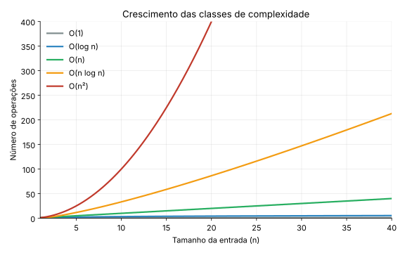
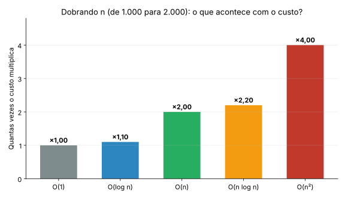
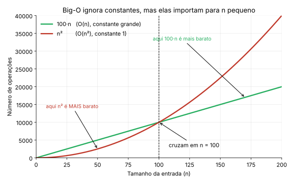
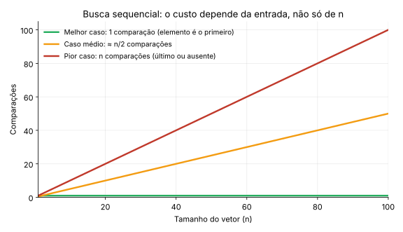
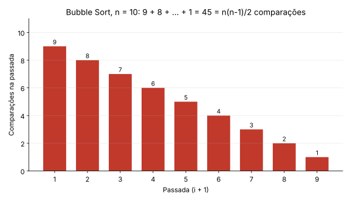

# Algoritmos de Ordenação Básicos

**Disciplina:** Estrutura de Dados

Neste capítulo estudamos três algoritmos clássicos de ordenação (**Bubble Sort**, **Selection Sort** e **Insertion Sort**) e, ao mesmo tempo, aprendemos a **analisá-los**: a teoria de complexidade (notação Big-O) é apresentada aqui, na Seção 2, e usada em todos os algoritmos que vêm depois.

!!! note "Material de Apoio"
    Você pode complementar este capítulo com os [Slides sobre Algoritmos de Ordenação Básicos](../slides/ordenacao_algoritmos_basicos.pdf).

!!! info "Onde este capítulo se encaixa"
    - **Este capítulo:** algoritmos O(n²) e toda a teoria de complexidade.
    - **Próximo capítulo:** algoritmos eficientes, O(n log n) (Merge Sort, Quick Sort e Heap Sort).
    - **Capítulo de Análise Experimental e Ferramentas:** como *medir* o que a teoria prevê (tempo, contagem de operações, `gcov`, `gprof` e `cppcheck`). É ele que sustenta o Trabalho Prático de Ordenação.

---

## 1. O Que É Ordenação?

> **Definição:** Ordenação é o processo de rearranjar os elementos de uma coleção em uma sequência específica, geralmente **crescente** ou **decrescente**, com base em uma chave de comparação.

```text
// Exemplo: vetor não ordenado → ordenado (crescente)
Entrada:  [64, 34, 25, 12, 22, 11, 90]
Saída:    [11, 12, 22, 25, 34, 64, 90]
```

### 1.1 Aplicações Práticas da Ordenação

| Aplicação | Benefício da Ordenação |
| --- | --- |
| Busca em listas | Busca binária exige dados ordenados → O(log n) vs O(n) |
| Remoção de duplicatas | Elementos iguais ficam adjacentes → detecção O(n) |
| Relatórios e visualização | Dados organizados facilitam interpretação humana |
| Processamento de bancos de dados | Índices ordenados aceleram consultas |
| Algoritmos de união/interseção | Operações em conjuntos tornam-se lineares |

!!! tip "Insight"
    Muitos algoritmos complexos assumem dados ordenados como pré-condição. Ordenar pode ser o "custo inicial" que viabiliza operações eficientes depois.

---

## 2. Complexidade de Algoritmos

Esta seção reúne toda a teoria de que precisamos. Os capítulos seguintes apenas a aplicam. Ela está organizada do mais intuitivo para o mais formal: primeiro a ideia, depois a notação, depois uma receita para analisar código.

### 2.1 Por Que Analisar Complexidade?

Dois algoritmos podem resolver o mesmo problema, mas com desempenhos drasticamente diferentes conforme o tamanho da entrada `n`.

```text
Algoritmo A: ordena 1000 elementos em 0.01s
Algoritmo B: ordena 1000 elementos em 2.5s

Qual usar para 1 milhão de elementos?
→ Precisamos de uma métrica independente de hardware: COMPLEXIDADE.
```

Medir o tempo com um cronômetro tem dois problemas: o resultado **depende da máquina** (compilador, processador, carga do sistema) e só vale para os tamanhos que você testou. A análise de complexidade resolve isso respondendo a uma pergunta diferente:

> **Quando o tamanho da entrada cresce, como cresce a quantidade de trabalho do algoritmo?**

### 2.2 A Ideia Central: Contar Operações em Função de `n`

Em vez de medir segundos, **contamos operações básicas** (comparações, trocas, atribuições) em função do tamanho da entrada `n`. O resultado é uma função de custo, que chamamos de `T(n)`.

**Exemplo: encontrar o maior elemento de um vetor.**

```c
int maximo(int v[], int n) {
    int max = v[0];                 // 1 atribuição
    for (int i = 1; i < n; i++) {   // o corpo roda n-1 vezes
        if (v[i] > max) {           // 1 comparação por iteração
            max = v[i];
        }
    }
    return max;
}
```

O laço faz `n - 1` comparações, então `T(n) = n - 1` comparações (mais algumas operações constantes). Se `n` dobra, o trabalho dobra: o crescimento é **linear**.

**Mas por que podemos ignorar constantes e termos pequenos?** Considere um algoritmo com custo `T(n) = 3n² + 5n + 2`. Veja quanto do custo total vem do termo `3n²`:

| `n` | 3n² | 5n + 2 | Parte do total que vem de 3n² |
| --- | --- | --- | --- |
| 10 | 300 | 52 | 85% |
| 100 | 30.000 | 502 | 98,4% |
| 1.000 | 3.000.000 | 5.002 | 99,8% |

Quanto maior o `n`, mais o termo de maior ordem domina e o restante fica irrelevante. Por isso dizemos que o algoritmo "é da ordem de n²" e escrevemos `O(n²)`. É isso que a notação Big-O captura: o **comportamento de crescimento**, sem os detalhes.

### 2.3 Notação Big-O: Limite Superior

Dizemos que `f(n) = O(g(n))` se existem constantes `c > 0` e `n₀` tais que:

```text
f(n) ≤ c · g(n)    para todo n ≥ n₀
```

Em palavras: a partir de algum tamanho `n₀`, a função `f` nunca ultrapassa um múltiplo constante de `g`. Big-O é um **limite superior** do crescimento: "o custo cresce **no máximo** como `g(n)`".

**Exemplo.** Se `f(n) = 3n² + 5n`, então `f(n) = O(n²)`: para `n ≥ 1` vale `3n² + 5n ≤ 3n² + 5n² = 8n²`, ou seja, `c = 8` e `n₀ = 1`. As constantes `c` e `n₀` são o que permite **descartar constantes e termos de menor ordem**.

!!! warning "Big-O é uma notação para funções, não para casos"
    Podemos falar do pior caso, do melhor caso ou do caso médio de um algoritmo, e **cada um tem a sua função de custo**. Quando se diz apenas "o algoritmo é O(n²)", costuma-se referir ao **pior caso**.

### 2.4 Notações Irmãs: Ω e Θ

| Notação | Significado | Leitura informal | Definição |
| --- | --- | --- | --- |
| **O(g(n))** | Limite **superior** | "cresce **no máximo** como `g`" | `f(n) ≤ c · g(n)` a partir de algum `n₀` |
| **Ω(g(n))** | Limite **inferior** | "cresce **no mínimo** como `g`" | `f(n) ≥ c · g(n)` a partir de algum `n₀` |
| **Θ(g(n))** | Limite **justo** | "cresce **exatamente** como `g`" | `f(n)` é ao mesmo tempo O(g(n)) e Ω(g(n)) |

Por exemplo, o Selection Sort faz sempre `n(n-1)/2` comparações; portanto o número de comparações é **Θ(n²)** em qualquer entrada: nunca é menos, nunca é mais que a ordem de n².

!!! note "Um cuidado com o vocabulário"
    Dizer "o Insertion Sort é O(n²)" é correto (é um limite superior), mas diz pouco, porque no melhor caso ele é O(n). Ao descrever um algoritmo, sempre deixe claro **de qual caso** você está falando.

### 2.5 Classes de Complexidade Comuns

| Notação | Nome | Exemplo prático | Comportamento |
| --- | --- | --- | --- |
| **O(1)** | Constante | Acesso a elemento de vetor por índice | O tempo não muda, independente do tamanho dos dados. |
| **O(log n)** | Logarítmica | Busca binária, inserção em Árvore AVL | O tamanho do problema é dividido pela metade a cada passo. Cresce muito devagar. |
| **O(n)** | Linear | Busca sequencial, percurso de lista encadeada | O tempo cresce proporcionalmente ao tamanho da entrada. |
| **O(n log n)** | Linearítmica | Merge Sort, Quick Sort (caso médio), Heap Sort | Complexidade típica de algoritmos eficientes de ordenação. |
| **O(n²)** | Quadrática | Bubble, Selection e Insertion Sort (pior caso) | Laços aninhados. Dobrar a entrada **quadruplica** o tempo. |
| **O(2ⁿ)** | Exponencial | Força bruta em subconjuntos | Inviável, exceto para `n` muito pequeno. |

**Como cada classe aparece no código:**

```c
// O(1): o custo não depende de n
int primeiro(int v[]) { return v[0]; }

// O(n): um laço que percorre o vetor uma vez
long soma(int v[], int n) {
    long s = 0;
    for (int i = 0; i < n; i++) s += v[i];
    return s;
}

// O(log n): o problema é dividido pela metade a cada passo
int contaMetades(int n) {
    int passos = 0;
    while (n > 1) { n = n / 2; passos++; }   // n = 1024 → 10 passos
    return passos;
}

// O(n²): dois laços aninhados, cada um com n iterações
int contaPares(int n) {
    int pares = 0;
    for (int i = 0; i < n; i++)
        for (int j = 0; j < n; j++)
            pares++;                          // executa n × n vezes
    return pares;
}
```

Para sentir a diferença, veja o número aproximado de operações:

| `n` | log₂ n | n log₂ n | n² |
| --- | --- | --- | --- |
| 10 | ≈ 3 | ≈ 33 | 100 |
| 1.000 | ≈ 10 | ≈ 10.000 | 1.000.000 |
| 1.000.000 | ≈ 20 | ≈ 20.000.000 | 10¹² |

Com um milhão de elementos, um algoritmo O(n log n) faz cerca de 20 milhões de operações, enquanto um O(n²) faz **um trilhão**. É a diferença entre uma fração de segundo e horas de processamento.

### 2.6 Visualizando o Crescimento

#### Comparação das curvas



Como ler: o eixo horizontal é o tamanho da entrada e o vertical é o número de operações. As curvas O(1) e O(log n) quase não saem do chão; O(n) é uma reta; O(n log n) sobe um pouco acima da reta; e O(n²) dispara. Para `n` pequeno as curvas ficam próximas, e é conforme `n` cresce que a diferença aparece.

#### O que acontece quando a entrada dobra?



Esta é a forma mais prática de **reconhecer a complexidade medindo**: dobre `n` e observe o tempo. Se o tempo dobra, é linear. Se quadruplica, é quadrático. Se pouco mais que dobra, é O(n log n). Usaremos esse teste no capítulo de Análise Experimental.

#### Constantes importam para `n` pequeno



Big-O ignora constantes, e isso é correto para `n` grande. Mas um algoritmo O(n) com constante 100 (`100·n`) é **mais lento** que um O(n²) com constante 1 (`n²`) enquanto `n < 100`. Por isso, para vetores pequenos, algoritmos "piores" no papel, como o Insertion Sort, podem vencer algoritmos mais sofisticados.

### 2.7 Melhor Caso, Pior Caso e Caso Médio

O mesmo algoritmo pode se comportar de forma diferente conforme a **entrada** (aleatória, já ordenada, invertida), mesmo com o mesmo `n`.

**Exemplo clássico: busca sequencial** de um valor `x` em um vetor de `n` elementos.

- **Melhor caso:** `x` é o primeiro elemento → **1 comparação**, O(1).
- **Pior caso:** `x` é o último elemento ou não está no vetor → **`n` comparações**, O(n).
- **Caso médio:** `x` está, em média, no meio → **≈ n/2 comparações**, ainda O(n).



| Cenário | Definição | Exemplo (Bubble Sort otimizado) |
| --- | --- | --- |
| **Melhor caso** | Entrada que minimiza as operações | Vetor já ordenado → O(n) |
| **Pior caso** | Entrada que maximiza as operações | Vetor em ordem inversa → O(n²) |
| **Caso médio** | Comportamento esperado em entradas aleatórias | Vetor aleatório → O(n²) |

!!! warning "Importante"
    Em sistemas críticos, planeje sempre para o **pior caso**. O "caso médio" pode não ocorrer quando você mais precisa.

### 2.8 Receita: Como Analisar um Código

Para encontrar a complexidade de um trecho de código, aplique estas regras:

| Situação no código | Custo | Regra |
| --- | --- | --- |
| Comando simples (atribuição, comparação, `v[i]`) | O(1) | Custo constante |
| Comandos em **sequência** | soma dos custos | Vale o **maior** deles |
| Laço de `n` iterações | `n` × custo do corpo | Multiplica |
| Laços **aninhados** | produto das iterações | Multiplica os laços |
| Laço em que a variável **dobra ou divide** (`i *= 2`, `n /= 2`) | O(log n) | Metade do problema a cada passo |
| `if / else` | custo do ramo mais caro | Considere o **pior caso** |

**Exemplo resolvido 1: contando as comparações do Bubble Sort.**

```c
for (int i = 0; i < n - 1; i++) {
    for (int j = 0; j < n - i - 1; j++) {
        if (vetor[j] > vetor[j + 1]) { /* troca */ }
    }
}
```

O laço interno **não** tem sempre o mesmo tamanho: na passada `i`, ele faz `n - i - 1` comparações. Somando todas as passadas:

```text
(n-1) + (n-2) + ... + 2 + 1  =  n(n-1)/2  =  n²/2 - n/2
```



Para `n = 10` são `9 + 8 + ... + 1 = 45` comparações. As barras formam um **triângulo** cuja área é `n(n-1)/2`. Descartando a constante `1/2` e o termo de menor ordem `n/2`, ficamos com **O(n²)**.

**Exemplo resolvido 2: um código com dois blocos.**

```c
int temDuplicata(int v[], int n) {
    for (int i = 0; i < n; i++) {           // n iterações
        for (int j = i + 1; j < n; j++) {   // até n-1 iterações
            if (v[i] == v[j]) return 1;
        }
    }
    return 0;
}
```

No pior caso (sem duplicatas), o laço interno faz `(n-1) + (n-2) + ... + 0 = n(n-1)/2` comparações: **O(n²)**. No melhor caso (`v[0] == v[1]`), retorna na primeira comparação: **O(1)**. Repare como o mesmo código tem funções de custo diferentes para o melhor e o pior caso.

### 2.9 Complexidade de Espaço

Além do tempo, podemos analisar a **memória extra** que o algoritmo usa, sem contar o próprio vetor de entrada.

- **O(1):** usa só algumas variáveis (`i`, `j`, `temp`). É o caso dos três algoritmos deste capítulo, que ordenam *in-place* (no próprio vetor).
- **O(n):** precisa de um vetor auxiliar do tamanho da entrada, como o Merge Sort, que veremos no próximo capítulo.

### 2.10 Erros Comuns ao Interpretar Big-O

- **"O(n²) significa que leva n² segundos."** Não. Big-O descreve como o custo **cresce**, não quanto tempo leva.
- **"O algoritmo O(n) sempre é mais rápido que o O(n²)."** Só para `n` grande o suficiente (veja o gráfico das constantes).
- **"Big-O é sempre o pior caso."** Big-O é um limite superior de uma função; qual função (melhor, médio ou pior caso) depende de você dizer.
- **"Dois laços = O(n²)."** Só se estiverem **aninhados**. Dois laços em sequência, cada um com `n` iterações, somam `2n`, que é O(n).

### 2.11 A Teoria Prevê, a Medição Confirma

A análise teórica diz **como** o custo cresce. Para verificar isso no seu computador, medimos o tempo de execução e **contamos operações** (comparações e trocas). Essa parte, com as ferramentas `gcov`, `gprof` e `cppcheck`, está no capítulo de **Análise Experimental e Ferramentas**. Aqui usaremos apenas medições simples para ilustrar.

---

## 3. Bubble Sort: O Algoritmo da "Bolha"

### 3.1 Ideia Conceitual

> **Analogia:** Imagine bolhas de ar subindo num copo de refrigerante até a superfície. No Bubble Sort, a cada passada o maior elemento ainda fora do lugar "sobe" como uma bolha até o final do vetor.

**Estratégia:**

1. Compare elementos adjacentes
2. Se estiverem fora de ordem, troque-os
3. Repita até que nenhuma troca seja necessária

### 3.2 Exemplo Visual Passo a Passo

```text
Vetor inicial: [5, 3, 8, 4, 2]

Passada 1 (maior elemento "flutua" para o final):
[5,3,8,4,2] → [3,5,8,4,2]  (troca 5↔3)
[3,5,8,4,2] → [3,5,8,4,2]  (5<8, sem troca)
[3,5,8,4,2] → [3,5,4,8,2]  (troca 8↔4)
[3,5,4,8,2] → [3,5,4,2,8]  (troca 8↔2) ✓ 8 na posição final

Passada 2:
[3,5,4,2,8] → [3,5,4,2,8]  (3<5)
[3,5,4,2,8] → [3,4,5,2,8]  (troca 5↔4)
[3,4,5,2,8] → [3,4,2,5,8]  (troca 5↔2) ✓ 5 na posição

Passada 3:
[3,4,2,5,8] → [3,4,2,5,8]  (3<4)
[3,4,2,5,8] → [3,2,4,5,8]  (troca 4↔2) ✓ 4 na posição

Passada 4:
[3,2,4,5,8] → [2,3,4,5,8]  (troca 3↔2) ✓ 3 na posição

Resultado: [2, 3, 4, 5, 8] ✓
```

### 3.3 Implementação em C (Versão Simples)

```c
#include <stdio.h>
#include <stdbool.h>

// Bubble Sort simples: sempre faz n(n-1)/2 comparações
void bubbleSort(int vetor[], int n) {
    for (int i = 0; i < n - 1; i++) {
        // Últimos i elementos já estão ordenados
        for (int j = 0; j < n - i - 1; j++) {
            if (vetor[j] > vetor[j + 1]) {
                // Troca elementos
                int temp = vetor[j];
                vetor[j] = vetor[j + 1];
                vetor[j + 1] = temp;
            }
        }
    }
}
```

### 3.4 Otimização: Parada Antecipada

```c
// Bubble Sort otimizado: O(n) no melhor caso (já ordenado)
void bubbleSortOtimizado(int vetor[], int n) {
    bool trocou;

    for (int i = 0; i < n - 1; i++) {
        trocou = false;  // Flag para detectar se houve troca

        for (int j = 0; j < n - i - 1; j++) {
            if (vetor[j] > vetor[j + 1]) {
                // Troca
                int temp = vetor[j];
                vetor[j] = vetor[j + 1];
                vetor[j + 1] = temp;
                trocou = true;
            }
        }

        // Se não houve troca, vetor já está ordenado
        if (!trocou) {
            printf("  → Parada antecipada na passada %d\n", i + 1);
            break;
        }
    }
}
```

!!! success "Ganho"
    Se o vetor já estiver ordenado, o algoritmo termina em **O(n)**, com apenas uma passada de verificação.

### 3.5 Análise de Complexidade

As duas versões se comportam de forma diferente, e é importante não confundi-las.

**Versão simples** (Seção 3.3): faz **sempre** `n(n-1)/2` comparações, qualquer que seja a entrada. O que muda com a entrada é o número de **trocas**.

| Entrada | Comparações | Trocas | Complexidade |
| --- | --- | --- | --- |
| Ordenado | n(n-1)/2 | 0 | **O(n²)** |
| Invertido | n(n-1)/2 | n(n-1)/2 | **O(n²)** |
| Aleatório | n(n-1)/2 | ≈ n²/4 | **O(n²)** |

**Versão otimizada** (Seção 3.4): para quando uma passada não troca nada.

| Cenário | Comparações | Trocas | Complexidade |
| --- | --- | --- | --- |
| **Melhor caso** (ordenado) | n-1 | 0 | **O(n)** |
| **Pior caso** (invertido) | n(n-1)/2 ≈ n²/2 | n(n-1)/2 ≈ n²/2 | **O(n²)** |
| **Caso médio** (aleatório) | ≈ n²/2 (um pouco menos) | ≈ n²/4 | **O(n²)** |

**Espaço:** O(1) — ordenação *in-place*, sem estruturas auxiliares.

!!! note "Por que isso importa"
    Só a versão com parada antecipada tem melhor caso O(n). Ao medir o Bubble Sort (veja o capítulo de Análise Experimental), confira **qual versão** você está medindo.

---

## 4. Selection Sort: Ordenação por Seleção

### 4.1 Ideia Conceitual

> **Analogia:** Organizar uma fila de pessoas por altura: procure a mais baixa e troque-a de lugar com quem está na frente; depois procure a mais baixa entre as restantes e coloque-a na segunda posição; e assim por diante.

**Estratégia:**

1. Encontre o menor elemento na parte não ordenada
2. Troque-o com o primeiro elemento não ordenado
3. Avance o limite da parte ordenada
4. Repita até ordenar tudo

### 4.2 Exemplo Visual Passo a Passo

```text
Vetor inicial: [64, 25, 12, 22, 11]
               ↑
               limite da parte ordenada

Passada 1: encontrar mínimo em [64,25,12,22,11] → 11
[64,25,12,22,11] → trocar 64↔11
[11,25,12,22,64] ✓ 11 na posição correta
       ↑

Passada 2: encontrar mínimo em [25,12,22,64] → 12
[11,25,12,22,64] → trocar 25↔12
[11,12,25,22,64] ✓ 12 na posição correta
          ↑

Passada 3: encontrar mínimo em [25,22,64] → 22
[11,12,25,22,64] → trocar 25↔22
[11,12,22,25,64] ✓ 22 na posição correta
             ↑

Passada 4: encontrar mínimo em [25,64] → 25 (já está correto)
[11,12,22,25,64] → sem troca necessária
                ↑

Resultado: [11, 12, 22, 25, 64] ✓
```

### 4.3 Implementação em C

```c
// Selection Sort: sempre O(n²), mas com menos trocas que Bubble
void selectionSort(int vetor[], int n) {
    for (int i = 0; i < n - 1; i++) {
        // Encontra o índice do menor elemento na parte não ordenada
        int indiceMenor = i;

        for (int j = i + 1; j < n; j++) {
            if (vetor[j] < vetor[indiceMenor]) {
                indiceMenor = j;
            }
        }

        // Troca apenas se necessário (evita troca consigo mesmo)
        if (indiceMenor != i) {
            int temp = vetor[i];
            vetor[i] = vetor[indiceMenor];
            vetor[indiceMenor] = temp;
        }
    }
}
```

### 4.4 Análise de Complexidade

| Cenário | Comparações | Trocas | Complexidade |
| --- | --- | --- | --- |
| **Melhor caso** (ordenado) | n(n-1)/2 ≈ n²/2 | 0 | **O(n²)** |
| **Vetor invertido** | n(n-1)/2 ≈ n²/2 | ⌊n/2⌋ | **O(n²)** |
| **Pior caso** (trocas) | n(n-1)/2 ≈ n²/2 | n-1 | **O(n²)** |
| **Caso médio** (aleatório) | ~n²/2 | ≈ n − ln n | **O(n²)** |

*(No vetor invertido, cada troca coloca dois elementos no lugar de uma vez, por isso são só n/2 trocas. O máximo de n−1 trocas ocorre, por exemplo, em `[2, 3, ..., n, 1]`.)*

**Espaço:** O(1) — ordenação *in-place*.

!!! tip "Vantagem do Selection Sort"
    Número de trocas é **sempre ≤ n-1**, útil quando trocar elementos é custoso (ex: registros grandes em disco).

---

## 5. Insertion Sort: Ordenação por Inserção

### 5.1 Ideia Conceitual

> **Analogia:** Organizar cartas na mão durante um jogo: pegue uma carta por vez e insira-a na posição correta entre as cartas já ordenadas.

**Estratégia:**

1. Considere o primeiro elemento como "ordenado"
2. Para cada elemento seguinte:
    - Compare com os elementos ordenados à esquerda
    - Desloque elementos maiores para a direita
    - Insira o elemento na posição correta
3. Repita até processar todos os elementos

### 5.2 Exemplo Visual Passo a Passo

```text
Vetor inicial: [5, 2, 4, 6, 1, 3]
               ↑
               elemento atual (i=1)

i=1: elemento=2
[5,2,4,6,1,3] → 5>2, desloca 5 para direita
[_,5,4,6,1,3] → insere 2 na posição 0
[2,5,4,6,1,3] ✓
     ↑

i=2: elemento=4
[2,5,4,6,1,3] → 5>4, desloca 5
[2,_,5,6,1,3] → 2<4, para de deslocar
[2,4,5,6,1,3] ✓
       ↑

i=3: elemento=6
[2,4,5,6,1,3] → 5<6, já está na posição correta
[2,4,5,6,1,3] ✓
         ↑

i=4: elemento=1
[2,4,5,6,1,3] → 6>1, desloca
[2,4,5,_,6,3] → 5>1, desloca
[2,4,_,5,6,3] → 4>1, desloca
[2,_,4,5,6,3] → 2>1, desloca
[_,2,4,5,6,3] → insere 1 na posição 0
[1,2,4,5,6,3] ✓
           ↑

i=5: elemento=3
[1,2,4,5,6,3] → 6>3, desloca
[1,2,4,5,_,6] → 5>3, desloca
[1,2,4,_,5,6] → 4>3, desloca
[1,2,_,4,5,6] → 2<3, para
[1,2,3,4,5,6] ✓

Resultado: [1, 2, 3, 4, 5, 6] ✓
```

### 5.3 Implementação em C

```c
// Insertion Sort: eficiente para vetores pequenos ou quase ordenados
void insertionSort(int vetor[], int n) {
    for (int i = 1; i < n; i++) {
        int chave = vetor[i];  // Elemento a ser inserido
        int j = i - 1;

        // Desloca elementos maiores que 'chave' para a direita
        while (j >= 0 && vetor[j] > chave) {
            vetor[j + 1] = vetor[j];  // Deslocamento
            j--;
        }

        // Insere 'chave' na posição correta
        vetor[j + 1] = chave;
    }
}
```

### 5.4 Análise de Complexidade

| Cenário | Comparações | Deslocamentos | Complexidade |
| --- | --- | --- | --- |
| **Melhor caso** (ordenado) | n-1 | 0 | **O(n)** |
| **Pior caso** (invertido) | n(n-1)/2 ≈ n²/2 | n(n-1)/2 ≈ n²/2 | **O(n²)** |
| **Caso médio** (aleatório) | ~n²/4 | ~n²/4 | **O(n²)** |

**Espaço:** O(1) — ordenação *in-place*.

!!! tip "Vantagem do Insertion Sort"
    - Estável (mantém ordem relativa de elementos iguais)
    - Adaptativo: eficiente quando o vetor já está "quase ordenado"
    - Online: pode ordenar elementos à medida que chegam

---

## 6. Código Completo Compilável (Teste os Três Algoritmos)

Neste código, o `bubbleSort` é a **versão otimizada** (com parada antecipada), para que o melhor caso do teste 2 seja visível.

```c
#include <stdio.h>
#include <stdlib.h>
#include <time.h>
#include <stdbool.h>

// ===== Utilitários =====
void imprimirVetor(int vetor[], int n, const char* mensagem) {
    printf("%s", mensagem);
    for (int i = 0; i < n; i++) {
        printf("%d ", vetor[i]);
    }
    printf("\n");
}

void copiarVetor(int origem[], int destino[], int n) {
    for (int i = 0; i < n; i++) {
        destino[i] = origem[i];
    }
}

bool estaOrdenado(int vetor[], int n) {
    for (int i = 0; i < n - 1; i++) {
        if (vetor[i] > vetor[i + 1]) {
            return false;
        }
    }
    return true;
}

// ===== Bubble Sort (versão otimizada) =====
void bubbleSort(int vetor[], int n) {
    for (int i = 0; i < n - 1; i++) {
        bool trocou = false;
        for (int j = 0; j < n - i - 1; j++) {
            if (vetor[j] > vetor[j + 1]) {
                int temp = vetor[j];
                vetor[j] = vetor[j + 1];
                vetor[j + 1] = temp;
                trocou = true;
            }
        }
        if (!trocou) break;  // Otimização: parada antecipada
    }
}

// ===== Selection Sort =====
void selectionSort(int vetor[], int n) {
    for (int i = 0; i < n - 1; i++) {
        int indiceMenor = i;
        for (int j = i + 1; j < n; j++) {
            if (vetor[j] < vetor[indiceMenor]) {
                indiceMenor = j;
            }
        }
        if (indiceMenor != i) {
            int temp = vetor[i];
            vetor[i] = vetor[indiceMenor];
            vetor[indiceMenor] = temp;
        }
    }
}

// ===== Insertion Sort =====
void insertionSort(int vetor[], int n) {
    for (int i = 1; i < n; i++) {
        int chave = vetor[i];
        int j = i - 1;
        while (j >= 0 && vetor[j] > chave) {
            vetor[j + 1] = vetor[j];
            j--;
        }
        vetor[j + 1] = chave;
    }
}

// ===== Medição de tempo (milissegundos) =====
double medirTempo(void (*func)(int[], int), int vetor[], int n) {
    clock_t inicio = clock();
    func(vetor, n);
    clock_t fim = clock();
    return ((double)(fim - inicio)) / CLOCKS_PER_SEC * 1000;  // em ms
}

// ===== Main: Comparação prática =====
int main() {
    // Vetor de teste
    int original[] = {64, 34, 25, 12, 22, 11, 90};
    int n = sizeof(original) / sizeof(original[0]);
    int vetor[100];  // buffer para cópias

    printf("=== Algoritmos de Ordenação Básicos ===\n\n");

    // Teste 1: Vetor aleatório pequeno
    printf("1. Vetor original: ");
    imprimirVetor(original, n, "");

    // Bubble Sort
    copiarVetor(original, vetor, n);
    double t1 = medirTempo(bubbleSort, vetor, n);
    printf("   Bubble Sort:   ");
    imprimirVetor(vetor, n, "");
    printf("   Tempo: %.3f ms | Ordenado? %s\n\n", t1, estaOrdenado(vetor, n) ? "✓" : "✗");

    // Selection Sort
    copiarVetor(original, vetor, n);
    double t2 = medirTempo(selectionSort, vetor, n);
    printf("   Selection Sort:");
    imprimirVetor(vetor, n, "");
    printf("   Tempo: %.3f ms | Ordenado? %s\n\n", t2, estaOrdenado(vetor, n) ? "✓" : "✗");

    // Insertion Sort
    copiarVetor(original, vetor, n);
    double t3 = medirTempo(insertionSort, vetor, n);
    printf("   Insertion Sort:");
    imprimirVetor(vetor, n, "");
    printf("   Tempo: %.3f ms | Ordenado? %s\n\n", t3, estaOrdenado(vetor, n) ? "✓" : "✗");

    // Teste 2: Vetor já ordenado (melhor caso para Insertion/Bubble otimizado)
    printf("2. Melhor caso (vetor já ordenado):\n");
    for (int i = 0; i < n; i++) original[i] = i + 1;

    copiarVetor(original, vetor, n);
    t1 = medirTempo(bubbleSort, vetor, n);
    printf("   Bubble Sort:   %.3f ms\n", t1);

    copiarVetor(original, vetor, n);
    t2 = medirTempo(selectionSort, vetor, n);
    printf("   Selection Sort: %.3f ms\n", t2);

    copiarVetor(original, vetor, n);
    t3 = medirTempo(insertionSort, vetor, n);
    printf("   Insertion Sort: %.3f ms ← mais rápido neste cenário!\n\n", t3);

    // Teste 3: Vetor invertido (pior caso)
    printf("3. Pior caso (vetor invertido):\n");
    for (int i = 0; i < n; i++) original[i] = n - i;

    copiarVetor(original, vetor, n);
    t1 = medirTempo(bubbleSort, vetor, n);
    printf("   Bubble Sort:   %.3f ms\n", t1);

    copiarVetor(original, vetor, n);
    t2 = medirTempo(selectionSort, vetor, n);
    printf("   Selection Sort: %.3f ms\n", t2);

    copiarVetor(original, vetor, n);
    t3 = medirTempo(insertionSort, vetor, n);
    printf("   Insertion Sort: %.3f ms\n\n", t3);

    printf("✅ Todos os algoritmos produziram resultados corretos!\n");
    printf("📌 Observação: Para vetores pequenos, as diferenças são mínimas.\n");
    printf("   Para n grande (>1000), algoritmos O(n²) tornam-se inviáveis.\n");

    return 0;
}
```

**Saída esperada (exemplo):**

```text
=== Algoritmos de Ordenação Básicos ===

1. Vetor original: 64 34 25 12 22 11 90
   Bubble Sort:   11 12 22 25 34 64 90
   Tempo: 0.002 ms | Ordenado? ✓

   Selection Sort:11 12 22 25 34 64 90
   Tempo: 0.001 ms | Ordenado? ✓

   Insertion Sort:11 12 22 25 34 64 90
   Tempo: 0.001 ms | Ordenado? ✓

2. Melhor caso (vetor já ordenado):
   Bubble Sort:   0.000 ms
   Selection Sort: 0.001 ms
   Insertion Sort: 0.000 ms ← mais rápido neste cenário!

3. Pior caso (vetor invertido):
   Bubble Sort:   0.003 ms
   Selection Sort: 0.002 ms
   Insertion Sort: 0.003 ms

✅ Todos os algoritmos produziram resultados corretos!
📌 Observação: Para vetores pequenos, as diferenças são mínimas.
   Para n grande (>1000), algoritmos O(n²) tornam-se inviáveis.
```

!!! note "Medir com mais rigor"
    Com `n = 7`, os tempos estão abaixo da resolução do relógio e não dizem nada. Para medir de verdade (vários valores de `n`, repetições, contagem de comparações e trocas), veja o capítulo de **Análise Experimental e Ferramentas**.

---

## 7. Comparação Direta: Qual Algoritmo Usar?

| Critério | Bubble Sort | Selection Sort | Insertion Sort |
| --- | --- | --- | --- |
| **Complexidade (pior caso)** | O(n²) | O(n²) | O(n²) |
| **Complexidade (melhor caso)** | O(n)* | O(n²) | O(n) |
| **Número de trocas** | O(n²) | **O(n)** ✓ | O(n²) |
| **Memória extra** | O(1) | O(1) | O(1) |
| **Estável** | ✓ | ✗ | ✓ |
| **Adaptativo** | ✓* | ✗ | ✓✓ |
| **Online** | ✗ | ✗ | ✓ |
| **Simplicidade** | ✓✓✓ | ✓✓ | ✓✓ |
| **Indicado para** | Ensino, vetores muito pequenos | Quando trocas são custosas | Vetores pequenos ou quase ordenados |

> *Com otimização de parada antecipada

### Regra Prática de Escolha

```text
✅ Use Insertion Sort se:
   - n < 50 (pequeno)
   - Dados já estão "quase ordenados"
   - Precisa de estabilidade

✅ Use Selection Sort se:
   - Trocar elementos é operação cara (ex: structs grandes)
   - Quer minimizar número de escritas na memória

✅ Use Bubble Sort se:
   - Está aprendendo conceitos de ordenação
   - Precisa de código extremamente simples para prototipagem

❌ Evite todos os três se:
   - n > 1000 → use Merge Sort, Quick Sort ou biblioteca padrão (qsort)
```

---

## 8. Exercícios para Fixação

### Exercício 1 — Simulação Manual

Dado o vetor `[8, 3, 5, 1, 9]`, simule passo a passo:

a) Bubble Sort (com otimização): quantas passadas foram necessárias?

b) Selection Sort: quantas trocas foram realizadas?

c) Insertion Sort: quantos deslocamentos ocorreram ao inserir o elemento `1`?

<details>
<summary>💡 Gabarito parcial</summary>

```text
a) Bubble Sort:
   Passada 1: [3,5,1,8,9] → trocas: 8↔3, 8↔5, 8↔1
   Passada 2: [3,1,5,8,9] → trocas: 5↔1
   Passada 3: [1,3,5,8,9] → trocas: 3↔1
   Passada 4: [1,3,5,8,9] → sem trocas → parada antecipada
   Total: 4 passadas (mas parou na 4ª por otimização)

b) Selection Sort:
   Troca 1: 8↔1 → [1,3,5,8,9]
   Troca 2: nenhuma (3 já é o menor do restante)
   Troca 3: nenhuma
   Troca 4: nenhuma
   Total: 1 troca

c) Insertion Sort ao inserir 1 (i=3):
   [3,5,8,1,9] → 8>1 → desloca → [3,5,_,8,9]
                → 5>1 → desloca → [3,_,5,8,9]
                → 3>1 → desloca → [_,3,5,8,9]
                → insere 1 → [1,3,5,8,9]
   Total: 3 deslocamentos
```

</details>

---

### Exercício 2 — Modificação de Código

Modifique o `insertionSort` para ordenar em **ordem decrescente**. Teste com `[5, 2, 8, 1, 9]`.

<details>
<summary>💡 Solução</summary>

```c
// Basta inverter a condição de comparação:
while (j >= 0 && vetor[j] < chave) {  // < em vez de >
    vetor[j + 1] = vetor[j];
    j--;
}
vetor[j + 1] = chave;

// Resultado esperado: [9, 8, 5, 2, 1]
```

</details>

---

### Exercício 3 — Contagem de Operações

Adicione contadores ao `bubbleSort` (versão simples, Seção 3.3) para registrar:

- `comparacoes`: número de vezes que `vetor[j] > vetor[j+1]` foi avaliado
- `trocas`: número de trocas efetivas realizadas

Execute com vetores de tamanhos 10, 50 e 100 (aleatórios) e preencha a tabela:

| n | Comparações | Trocas | Razão Trocas/Comparações |
| --- | --- | --- | --- |
| 10 | ? | ? | ? |
| 50 | ? | ? | ? |
| 100 | ? | ? | ? |

Depois, repita com um vetor **já ordenado**, primeiro na versão simples e depois na otimizada, e compare o número de comparações.

> 💡 **Objetivo:** Verificar empiricamente que o número de operações cresce quadraticamente e que a parada antecipada muda o melhor caso.

---

### Exercício 4 — Qual É a Complexidade?

Determine a complexidade de tempo de cada trecho (considere `x++` como uma operação de custo constante):

```c
// (a)
for (int i = 0; i < n; i++)
    for (int j = 0; j < n; j++)
        x++;

// (b)
for (int i = 0; i < n; i++) x++;
for (int j = 0; j < n; j++) y++;

// (c)
for (int i = 1; i < n; i *= 2) x++;

// (d)
for (int i = 0; i < n; i++)
    for (int j = 0; j < i; j++)
        x++;

// (e)
for (int i = 0; i < n; i++)
    for (int j = 1; j < n; j *= 2)
        x++;
```

<details>
<summary>💡 Gabarito</summary>

```text
(a) n × n = n²                          → O(n²)
(b) dois laços em SEQUÊNCIA: n + n = 2n → O(n)
(c) i dobra a cada passo: ≈ log₂ n      → O(log n)
(d) 0 + 1 + 2 + ... + (n-1) = n(n-1)/2  → O(n²)
(e) laço externo n × laço interno log n → O(n log n)
```

</details>

---

### Exercício 5 — Provando um Big-O

Mostre que `f(n) = 3n² + 5n` é `O(n²)`, indicando valores de `c` e `n₀`. A função `f(n) = 3n² + 5n` também é Ω(n²)? E Θ(n²)?

<details>
<summary>💡 Gabarito</summary>

```text
Para n ≥ 1: 3n² + 5n ≤ 3n² + 5n² = 8n²   →   c = 8, n₀ = 1.  Logo f(n) = O(n²).

Também vale 3n² + 5n ≥ 3n² para todo n ≥ 1   →   c = 3, n₀ = 1.  Logo f(n) = Ω(n²).

Como é O(n²) e Ω(n²), temos f(n) = Θ(n²).
```

</details>

---

### Exercício 6 — O Que Acontece Quando `n` Cresce?

Um algoritmo O(n²) ordena 1.000 elementos em 10 ms. Estime o tempo para 2.000 e para 10.000 elementos. E se o algoritmo fosse O(n log n)?

<details>
<summary>💡 Gabarito</summary>

```text
O(n²): dobrar n quadruplica o tempo.
  n = 2.000  → ≈ 4 × 10 ms   = 40 ms
  n = 10.000 → ≈ 100 × 10 ms = 1.000 ms (1 s), pois 10× mais dados custa 10² = 100×

O(n log n): dobrar n pouco mais que dobra o tempo.
  n = 2.000  → ≈ 2,2 × 10 ms ≈ 22 ms
  n = 10.000 → ≈ 13 × 10 ms  ≈ 130 ms
  (10× mais dados custa cerca de 10 · log₂(10.000)/log₂(1.000) ≈ 13×)

São estimativas: constantes ocultas, cache e o tamanho da entrada alteram os valores reais.
```

</details>

---

### Exercício 7 — Desafio: Ordenação de Structs

Defina uma struct para representar um aluno:

```c
typedef struct {
    int matricula;
    char nome[50];
    float nota;
} Aluno;
```

Implemente uma versão do `insertionSort` que ordene um vetor de `Aluno` por **nota decrescente**. Em caso de empate na nota, mantenha a ordem original de inserção (estabilidade).

<details>
<summary>💡 Esboço de solução</summary>

```c
void insertionSortAlunos(Aluno alunos[], int n) {
    for (int i = 1; i < n; i++) {
        Aluno chave = alunos[i];  // Cópia da struct
        int j = i - 1;

        // Comparação por nota (decrescente), mantendo estabilidade
        while (j >= 0 && alunos[j].nota < chave.nota) {
            alunos[j + 1] = alunos[j];  // Atribuição de struct funciona em C
            j--;
        }
        alunos[j + 1] = chave;
    }
}
```

</details>

---

## 9. Discussão: Por Que Estudar Algoritmos O(n²)?

### 9.1 Motivações Pedagógicas

✅ **Simplicidade conceitual:** Fáceis de entender, implementar e depurar

✅ **Base para algoritmos avançados:** Conceitos como "dividir para conquistar" (Merge/Quick Sort) são construídos sobre essas ideias

✅ **Eficiência em cenários específicos:** Para `n < 50`, a diferença entre O(n²) e O(n log n) é irrelevante na prática

✅ **Análise de complexidade:** Permitem exercitar contagem de operações e raciocínio assintótico

### 9.2 Quando O(n²) É Aceitável na Prática?

| Cenário | Justificativa |
| --- | --- |
| **n pequeno** (< 50) | Constantes escondidas no Big O dominam; código simples é mais manutenível |
| **Dados quase ordenados** | Insertion Sort adapta-se e opera em ~O(n) |
| **Restrições de memória** | Algoritmos in-place (O(1) espaço) podem ser preferíveis a Merge Sort (O(n) espaço) |
| **Prototipagem rápida** | Implementar Bubble Sort em 5 minutos pode ser mais produtivo que integrar biblioteca externa |

### 9.3 O Próximo Nível: Algoritmos O(n log n)

> 🔜 **No próximo capítulo:** Merge Sort, Quick Sort e Heap Sort — como quebrar a barreira O(n²) usando divisão e conquista.

```text
Comparação teórica para n = 10.000:

Algoritmo   | Comparações aproximadas | Relativo ao Merge*
------------|-------------------------|-------------------
Bubble      | 50.000.000  (n²/2)      | ~380x
Selection   | 50.000.000  (n²/2)      | ~380x
Insertion   | 25.000.000  (n²/4, médio)| ~190x
Merge Sort  | 130.000     (n log₂ n)  | 1x (base)
Quick Sort  | 180.000     (1,39 n log₂ n, médio) | ~1,4x

* Supondo o mesmo custo por comparação; na prática, constantes e
  acesso à memória mudam esses números.
```

---

## 10. Resumo do Capítulo

✅ **Complexidade**

- Big-O é um limite **superior**; Ω é o limite **inferior**; Θ é o limite **justo**
- Big-O descreve funções de custo: melhor, médio e pior caso têm funções diferentes
- Descartamos constantes e termos de menor ordem; dois laços aninhados sobre `n` resultam em O(n²)
- Dobrar `n` quadruplica o tempo de um algoritmo O(n²), e dobra o de um O(n)
- Receita: sequência soma, laços aninhados multiplicam, laço que divide ao meio é O(log n)
- Big-O ignora constantes, mas elas importam para `n` pequeno

✅ **Bubble Sort**

- Ideia: elementos maiores "flutuam" para o final
- Versão simples: sempre `n(n-1)/2` comparações
- Versão otimizada (parada antecipada): O(n) no melhor caso
- Simples, mas ineficiente para grandes conjuntos

✅ **Selection Sort**

- Ideia: selecionar o menor elemento e colocá-lo na posição correta
- Sempre O(n²) em comparações, mas com **mínimo de trocas** (≤ n-1)
- Útil quando trocar é operação custosa

✅ **Insertion Sort**

- Ideia: inserir cada elemento na posição correta entre os já ordenados
- O(n) no melhor caso (dados já ordenados ou quase)
- Estável, adaptativo e online — versátil para cenários reais

✅ **Boas práticas de implementação em C**

- Passar vetor por referência (já é padrão em C)
- Usar `bool` para flags de otimização
- Validar resultados com a função auxiliar `estaOrdenado()`
- Medir tempo com `clock()` e **confrontar com a teoria**

✅ **Critérios de escolha**

- Para ensino e pequenos dados: qualquer um dos três
- Para produção com `n` grande: migrar para Merge/Quick Sort
- Sempre considerar: tamanho dos dados, custo de troca, necessidade de estabilidade

---

## 11. Próximos Passos & Ferramentas

🔜 **No próximo capítulo:** Algoritmos eficientes de ordenação

- Merge Sort: divisão, conquista e intercalação
- Quick Sort: particionamento e pivô
- Heap Sort
- Comparação prática: quando usar cada um

🛠️ **No capítulo de Análise Experimental e Ferramentas:** medição rigorosa (vários `n`, repetições, comparações e trocas), cobertura com `gcov`, profiling com `gprof` e análise estática com `cppcheck`.

🛠️ **Prática sugerida:**

1. **Compile e execute** o código completo da Seção 6
2. **Modifique** para gerar vetores aleatórios de tamanhos variados (100, 1000, 5000)
3. **Meça e grafique** o tempo de execução vs. tamanho do vetor (use planilha ou Python)
4. **Valide** que o crescimento segue ~n² para os três algoritmos

📚 **Leitura complementar:**

- ZIVIANI, N. *Projeto de Algoritmos*. Capítulo 4: Ordenação.
- CORMEN et al. *Introduction to Algorithms*. Capítulo 2: Getting Started (análise de algoritmos).
- USP-IME. *Pythonds em Português*: [https://panda.ime.usp.br/panda/static/pythonds_pt/05-OrdenacaoBusca/](https://panda.ime.usp.br/panda/static/pythonds_pt/05-OrdenacaoBusca/)

---

> 📌 **Dica para provas e trabalhos:**
>
> - Ao analisar complexidade, **conte laços aninhados**: dois laços sobre `n` → O(n²)
> - Para simular algoritmos no papel, **desenhe o vetor a cada passo** — evita erros de raciocínio
> - Lembre-se: **Big O ignora constantes**, mas na prática, constantes importam para `n` pequeno!

---

*Material elaborado para a disciplina de Estrutura de Dados — Curso de Engenharia de Computação*

*Prof. Sérgio Souza Costa | Atualizado: 2026*
