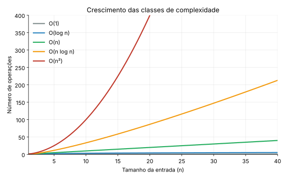
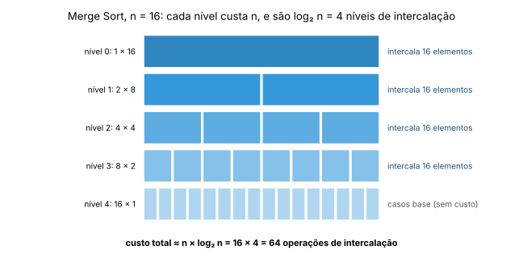
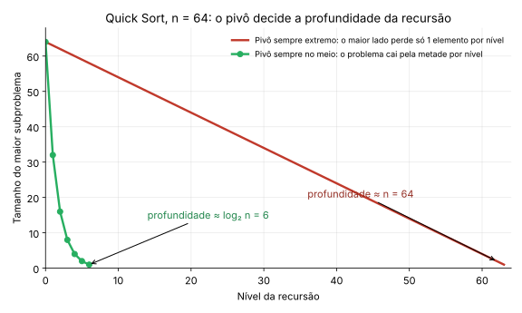

# Algoritmos de Ordenação Avançados

**Disciplina:** Estrutura de Dados

> *Continuação do capítulo anterior sobre ordenação. Agora exploramos técnicas O(n log n) e estratégias sofisticadas de ordenação.*

!!! info "Base teórica: capítulo anterior"
    Este capítulo **usa**, mas não repete, a teoria de complexidade apresentada na **Seção 2 do capítulo *Algoritmos de Ordenação Básicos***: notação Big-O, Ω e Θ, melhor/médio/pior caso, a receita para analisar código e o gráfico de crescimento. Se algum símbolo parecer estranho, volte a essa seção.

!!! info "Próximo capítulo"
    Depois deste capítulo vem o de **Análise Experimental e Ferramentas** (`gcov`, `gprof`, `cppcheck`), em que medimos na prática o que a teoria prevê para os algoritmos dos dois capítulos de ordenação.

---

## 1. Por Que Avançar Além do O(n²)?

### 1.1 O Limite Teórico da Comparação

> **Teorema:** Qualquer algoritmo de ordenação baseado **apenas em comparações** tem limite inferior de **Ω(n log n)** comparações no pior caso.

**A intuição.** Um vetor de `n` elementos distintos pode estar em `n!` ordens diferentes, e o algoritmo precisa descobrir qual delas é a correta. Cada comparação tem só dois resultados (maior ou menor), então com `k` comparações é possível distinguir no máximo `2ᵏ` casos. Para cobrir `n!` casos, precisamos de `2ᵏ ≥ n!`, ou seja, `k ≥ log₂(n!)`, que cresce como `n log n`. Nenhum algoritmo baseado em comparações pode fazer melhor que isso no pior caso.

Isso significa que **Merge Sort e Heap Sort são ótimos** (em pior caso) entre os algoritmos baseados em comparação: a ordem de crescimento deles, Θ(n log n), coincide com o limite inferior.

```text
Para n = 1.000.000:

Algoritmo O(n²)      → ~1.000.000.000.000 operações ❌
Algoritmo O(n log n) →        ~20.000.000 operações ✓

Diferença: 50.000× mais rápido!
```

Veja de novo, no gráfico do capítulo anterior, como a curva de n log n fica muito abaixo da de n² quando `n` cresce:



### 1.2 Estratégias para Quebrar a Barreira Quadrática

| Estratégia | Algoritmo | Ideia Central |
| --- | --- | --- |
| **Dividir e Conquistar** | Merge Sort, Quick Sort | Quebrar problema em subproblemas menores, resolver recursivamente, combinar resultados |
| **Estrutura de Dados Especializada** | Heap Sort | Usar heap (árvore binária completa) para extrair elementos em ordem |
| **Incrementos Decrescentes** | Shell Sort | Generalizar Insertion Sort com "gaps" para mover elementos distantes rapidamente |

> 💡 **Insight:** Não existe "melhor algoritmo universal". A escolha depende do contexto: tamanho dos dados, memória disponível, necessidade de estabilidade, padrão de entrada.

!!! tip "A receita de laços continua valendo, com uma novidade"
    Nos algoritmos O(n²) o custo vinha de **dois laços aninhados**. Aqui o custo vem de **recursão**: o problema é dividido (como nos laços que dividem `n` ao meio, O(log n)) e cada nível da recursão faz um trabalho proporcional a `n`. Resultado: `n` por nível × `log n` níveis = **n log n**. Veremos isso desenhado na Seção 2.5.

---

## 2. Merge Sort: Ordenação por Intercalação

### 2.1 Ideia Conceitual

> **Analogia:** Organizar duas pilhas de cartas já ordenadas: compare o topo de cada pilha, pegue o menor, repita. O Merge Sort aplica essa ideia recursivamente.

**Estratégia (Dividir e Conquistar):**

1. **Dividir:** Particionar o vetor ao meio
2. **Conquistar:** Ordenar recursivamente cada metade
3. **Combinar:** Intercalar as duas metades ordenadas em um vetor único ordenado

```text
                    [38, 27, 43, 3, 9, 82, 10, 4]
                              /        \
              [38, 27, 43, 3]            [9, 82, 10, 4]
                   /    \                    /    \
           [38, 27]      [43, 3]      [9, 82]      [10, 4]
             /  \          /  \         /  \          /  \
          [38]  [27]    [43]  [3]    [9]  [82]    [10]  [4]
             \  /          \  /         \  /          \  /
          [27,38]        [3,43]       [9,82]        [4,10]
                \          /               \          /
              [3,27,38,43]                [4,9,10,82]
                          \                      /
                    [3,4,9,10,27,38,43,82] ✓
```

### 2.2 A Operação Crucial: Merge (Intercalação)

```c
// Intercala dois subvetores ordenados: vetor[esq..mid] e vetor[mid+1..dir]
void merge(int vetor[], int esq, int mid, int dir) {
    int n1 = mid - esq + 1;  // tamanho do subvetor esquerdo
    int n2 = dir - mid;      // tamanho do subvetor direito

    // Cria vetores temporários
    int* L = (int*)malloc(n1 * sizeof(int));
    int* R = (int*)malloc(n2 * sizeof(int));
    if (L == NULL || R == NULL) {            // sempre verifique o malloc
        fprintf(stderr, "Erro: falha ao alocar memória\n");
        exit(1);
    }

    // Copia dados para os temporários
    for (int i = 0; i < n1; i++)
        L[i] = vetor[esq + i];
    for (int j = 0; j < n2; j++)
        R[j] = vetor[mid + 1 + j];

    // Intercala os temporários de volta no vetor original
    int i = 0, j = 0, k = esq;
    while (i < n1 && j < n2) {
        if (L[i] <= R[j]) {  // <= mantém estabilidade
            vetor[k++] = L[i++];
        } else {
            vetor[k++] = R[j++];
        }
    }

    // Copia elementos restantes (se houver)
    while (i < n1) vetor[k++] = L[i++];
    while (j < n2) vetor[k++] = R[j++];

    free(L);
    free(R);
}
```

> ✅ **Estabilidade:** O uso de `<=` (em vez de `<`) garante que elementos iguais mantenham sua ordem relativa.

!!! tip "Verifique o `malloc`"
    O `cppcheck` (capítulo de Análise Experimental) acusa uso de ponteiro que pode ser nulo quando o retorno do `malloc` não é testado. Por isso a versão acima verifica `L` e `R`.

### 2.3 Implementação Completa em C

```c
// Função recursiva principal do Merge Sort
void mergeSort(int vetor[], int esq, int dir) {
    if (esq < dir) {
        int mid = esq + (dir - esq) / 2;  // Evita overflow em esq+dir

        // Ordena primeira e segunda metade
        mergeSort(vetor, esq, mid);
        mergeSort(vetor, mid + 1, dir);

        // Intercala as metades ordenadas
        merge(vetor, esq, mid, dir);
    }
}

// Wrapper para facilitar chamada externa
void mergeSortWrapper(int vetor[], int n) {
    mergeSort(vetor, 0, n - 1);
}
```

### 2.4 Exemplo Visual Passo a Passo

```text
Vetor: [38, 27, 43, 3]

Divisão recursiva:
[38,27,43,3] → [38,27] e [43,3]
[38,27] → [38] e [27] → merge → [27,38]
[43,3]  → [43] e [3]  → merge → [3,43]

Intercalação final:
L = [27,38], R = [3,43]
k=0: 27>3 → pega 3  → [3,_,_,_]
k=1: 27<43 → pega 27 → [3,27,_,_]
k=2: 38<43 → pega 38 → [3,27,38,_]
k=3: copia 43        → [3,27,38,43] ✓
```

### 2.5 Análise de Complexidade: de Onde Vem o n log n?

Para contar o custo, olhe os **níveis da recursão**. Em cada nível, os subvetores têm tamanhos que somam `n`, e a intercalação toca cada elemento uma vez. Logo:

- **Custo de cada nível:** ≈ `n` (cada elemento é copiado e comparado um número constante de vezes).
- **Número de níveis:** o vetor é dividido ao meio até chegar a tamanho 1, o que acontece em `log₂ n` passos (a mesma lógica do laço `while (n > 1) n = n / 2` do capítulo anterior).
- **Custo total:** `n × log₂ n`.



| Cenário | Comparações | Espaço Auxiliar | Complexidade |
| --- | --- | --- | --- |
| **Melhor caso** | ~n log n / 2 | O(n) | **O(n log n)** |
| **Pior caso** | ~n log n | O(n) | **O(n log n)** |
| **Caso médio** | ~n log n | O(n) | **O(n log n)** |

O número de comparações no melhor caso é cerca da metade do pior, mas a **ordem de crescimento é a mesma**: o tempo do Merge Sort é **Θ(n log n)** em qualquer entrada.

**Espaço:** além dos vetores temporários `L` e `R` (que somam até `n` elementos em uma intercalação), a recursão usa uma pilha de profundidade `log n`. Uma otimização comum é alocar **um único** vetor auxiliar de tamanho `n` no início, em vez de um `malloc` por intercalação.

**Características:**

- ✅ **Estável**: mantém ordem de elementos iguais
- ✅ **Previsível**: sempre O(n log n), independente da entrada
- ❌ **Não in-place**: requer O(n) de memória extra
- ❌ **Overhead recursivo**: chamadas de função podem impactar performance para n pequeno

> 💡 **Dica prática:** Para vetores pequenos (n < 32), combine Merge Sort com Insertion Sort nos casos base para reduzir overhead. É a ideia das "constantes importam para `n` pequeno" do capítulo anterior.

---

## 3. Quick Sort: Ordenação por Particionamento

### 3.1 Ideia Conceitual

> **Analogia:** Organizar livros em uma estante: escolha um livro como referência (pivô), coloque todos os menores à esquerda e os maiores à direita. Repita o processo em cada lado.

**Estratégia (Dividir e Conquistar):**

1. **Escolher um pivô** (elemento de referência)
2. **Particionar**: reorganizar o vetor de forma que:
    - Elementos ≤ pivô fiquem à esquerda
    - Elementos ≥ pivô fiquem à direita
3. **Recursivamente** ordenar as subpartições esquerda e direita

```text
Vetor: [10, 80, 30, 90, 40, 50, 70], pivô = 70 (último elemento)

Particionamento (i começa em -1; j percorre de 0 a 5):

j=0: 10≤70 → i=0, troca v[0]↔v[0] → [10, 80, 30, 90, 40, 50, 70]
j=1: 80>70 → ignora
j=2: 30≤70 → i=1, troca v[1]↔v[2] → [10, 30, 80, 90, 40, 50, 70]
j=3: 90>70 → ignora
j=4: 40≤70 → i=2, troca v[2]↔v[4] → [10, 30, 40, 90, 80, 50, 70]
j=5: 50≤70 → i=3, troca v[3]↔v[5] → [10, 30, 40, 50, 80, 90, 70]

Final: troca pivô com v[i+1] = v[4] → [10, 30, 40, 50, 70, 90, 80]
                                                   ↑
                                  pivô (70) na posição correta (índice 4)

Agora recursivamente: ordena [10,30,40,50] e [90,80]
```

### 3.2 Implementação em C (Esquema de Lomuto)

```c
// Particionamento de Lomuto: pivô é o último elemento
int partition(int vetor[], int esq, int dir) {
    int pivo = vetor[dir];  // Escolhe último elemento como pivô
    int i = esq - 1;        // Índice do menor elemento

    for (int j = esq; j < dir; j++) {
        // Se elemento atual é menor ou igual ao pivô
        if (vetor[j] <= pivo) {
            i++;  // Incrementa índice do menor elemento
            // Troca vetor[i] e vetor[j]
            int temp = vetor[i];
            vetor[i] = vetor[j];
            vetor[j] = temp;
        }
    }
    // Coloca pivô na posição correta
    int temp = vetor[i + 1];
    vetor[i + 1] = vetor[dir];
    vetor[dir] = temp;

    return i + 1;  // Retorna índice do pivô
}

// Quick Sort recursivo
void quickSort(int vetor[], int esq, int dir) {
    if (esq < dir) {
        // pi é o índice de particionamento, vetor[pi] já está na posição correta
        int pi = partition(vetor, esq, dir);

        // Ordena elementos antes e depois da partição
        quickSort(vetor, esq, pi - 1);
        quickSort(vetor, pi + 1, dir);
    }
}

// Wrapper
void quickSortWrapper(int vetor[], int n) {
    quickSort(vetor, 0, n - 1);
}
```

!!! note "Outra forma de particionar"
    O exemplo do capítulo de Análise Experimental usa um esquema diferente (de Hoare), com o pivô no **elemento do meio** (`v[n/2]`). Por isso, naquele exemplo, um vetor já ordenado **não** é o pior caso. Aqui, com o pivô no **último** elemento (Lomuto), é. O pivô é o que decide o comportamento do Quick Sort, como veremos na Seção 3.4.

### 3.3 Otimizações Importantes

```c
void trocar(int *a, int *b) { int t = *a; *a = *b; *b = t; }

// 1. Escolha de pivô: Mediana de 3 (reduz chance de pior caso)
// Ordena vetor[esq], vetor[mid], vetor[dir] e leva a mediana para vetor[dir],
// que é onde o partition de Lomuto (Seção 3.2) espera encontrar o pivô.
int medianaDe3(int vetor[], int esq, int dir) {
    int mid = esq + (dir - esq) / 2;

    if (vetor[esq] > vetor[mid]) trocar(&vetor[esq], &vetor[mid]);
    if (vetor[esq] > vetor[dir]) trocar(&vetor[esq], &vetor[dir]);
    if (vetor[mid] > vetor[dir]) trocar(&vetor[mid], &vetor[dir]);
    // Agora vetor[esq] <= vetor[mid] <= vetor[dir]: a mediana está em mid

    trocar(&vetor[mid], &vetor[dir]);
    return vetor[dir];
}

// Insertion Sort restrito ao intervalo vetor[esq..dir]
void insertionSortRange(int vetor[], int esq, int dir) {
    for (int i = esq + 1; i <= dir; i++) {
        int chave = vetor[i];
        int j = i - 1;
        while (j >= esq && vetor[j] > chave) {
            vetor[j + 1] = vetor[j];
            j--;
        }
        vetor[j + 1] = chave;
    }
}

// 2. Quick Sort com mediana-de-3, corte para Insertion Sort e pilha limitada
void quickSortOtimizado(int vetor[], int esq, int dir) {
    while (dir - esq + 1 >= 10) {
        medianaDe3(vetor, esq, dir);
        int pi = partition(vetor, esq, dir);

        // Recursão só no MENOR lado; o maior é tratado pelo próprio laço.
        // Assim a profundidade da pilha fica limitada a O(log n).
        if (pi - esq < dir - pi) {
            quickSortOtimizado(vetor, esq, pi - 1);
            esq = pi + 1;
        } else {
            quickSortOtimizado(vetor, pi + 1, dir);
            dir = pi - 1;
        }
    }
    // Subvetores pequenos (< 10 elementos): Insertion Sort
    insertionSortRange(vetor, esq, dir);
}
```

### 3.4 Análise de Complexidade: o Pivô Decide a Profundidade

Como no Merge Sort, cada nível da recursão faz um particionamento que percorre os elementos uma vez (custo ≈ `n`). A diferença é que **a profundidade da recursão não é garantida**: depende de quão bem o pivô divide o vetor.



- **Pivô no meio (melhor caso):** o problema cai pela metade a cada nível. São `log₂ n` níveis × `n` por nível = **O(n log n)**.
- **Pivô extremo (pior caso):** a partição separa `n-1` elementos de `0`. O problema cai de 1 em 1, são `n` níveis, e o custo total é `(n-1) + (n-2) + ... + 1 = n(n-1)/2`, o **mesmo triângulo** do Bubble Sort (Seção 2.8 do capítulo anterior). Resultado: **O(n²)**.
- **Caso médio:** com pivôs "razoáveis" (entrada aleatória), o custo médio é ≈ `1,39 · n log₂ n` comparações, ou seja, **O(n log n)** com constante pequena.

| Cenário | Comparações | Espaço (stack) | Complexidade |
| --- | --- | --- | --- |
| **Melhor caso** (pivô sempre no meio) | ~n log n | O(log n) | **O(n log n)** |
| **Pior caso** (pivô sempre extremo) | ~n²/2 | O(n) | **O(n²)** ⚠️ |
| **Caso médio** (entrada aleatória) | ~1.39 n log n | O(log n) | **O(n log n)** |

**Quais entradas causam o pior caso?** Com o particionamento de Lomuto e o pivô no **último** elemento:

- vetor **já ordenado** (crescente);
- vetor em ordem **inversa**;
- vetor com **todas as chaves iguais** (o `<=` manda todos os elementos para o mesmo lado).

**Medições reais** (compilado com `gcc -O2`; os tempos variam entre máquinas, mas a proporção não):

| Entrada (n = 20.000) | Pivô fixo (último) | Mediana-de-3 |
| --- | --- | --- |
| Aleatória | 1,3 ms | (similar) |
| Já ordenada | **161,9 ms** | **0,3 ms** |
| Todas iguais | **165,0 ms** | (veja a nota abaixo) |

Para `n = 1.000` e vetor ordenado, o pivô fixo faz exatamente `1000 · 999 / 2 = 499.500` comparações no particionamento, contra cerca de 8 mil com a mediana-de-3.

!!! note "Mediana-de-3 e chaves repetidas"
    A mediana-de-3 resolve os casos ordenado e invertido, mas **não** resolve o vetor de chaves todas iguais com o `partition` de Lomuto. Para muitas chaves repetidas, use o Quick Sort de **3 partições** (menores, iguais, maiores).

**Características:**

- ✅ **In-place**: ordena sem memória auxiliar significativa
- ✅ **Cache-friendly**: acesso sequencial aos dados
- ✅ **Na prática**: frequentemente mais rápido que Merge Sort devido a constantes menores
- ❌ **Não estável**: pode alterar ordem relativa de elementos iguais
- ❌ **Pior caso O(n²)**: mitigado com escolha inteligente de pivô

> ⚠️ **Atenção:** O pior caso ocorre com vetores já ordenados quando o pivô é sempre o primeiro/último elemento. Use mediana-de-3 ou randomização para evitar.

---

## 4. Shell Sort: Insertion Sort com "Saltos"

### 4.1 Ideia Conceitual

> **Analogia:** Organizar uma fila de pessoas por altura: primeiro ajuste pessoas distantes (ex: posição 1 com 5, 2 com 6), depois reduza a distância. O Shell Sort generaliza o Insertion Sort permitindo comparações entre elementos distantes.

**Estratégia:**

1. Escolher uma **sequência de gaps** (incrementos decrescentes)
2. Para cada gap `g`:
    - Aplicar Insertion Sort em subvetores formados por elementos a distância `g`
3. Quando `gap = 1`, executar Insertion Sort final (dados já "quase ordenados")

```text
Vetor: [9, 8, 3, 7, 5, 6, 4, 1], gaps = [4, 2, 1]

Gap = 4:
Subvetores: [9,5], [8,6], [3,4], [7,1]
Após Insertion Sort em cada: [5,6,3,1,9,8,4,7]

Gap = 2:
Subvetores: [5,3,9,4], [6,1,8,7]
Após Insertion Sort: [3,1,4,6,5,7,9,8]

Gap = 1 (Insertion Sort tradicional):
[1,3,4,5,6,7,8,9] ✓
```

A ideia lembra a vantagem do Insertion Sort em dados "quase ordenados" (melhor caso O(n), Seção 5.4 do capítulo anterior): os passos com gaps grandes deixam o vetor quase ordenado para o passo final com `gap = 1`.

### 4.2 Implementação em C

```c
// Shell Sort com sequência de Knuth: gaps = 1, 4, 13, 40, 121, ... (g = 3*g + 1)
void shellSort(int vetor[], int n) {
    // Calcula gap inicial usando sequência de Knuth
    int gap = 1;
    while (gap < n / 3) {
        gap = 3 * gap + 1;  // 1, 4, 13, 40, 121, ...
    }

    // Reduz gap gradualmente
    while (gap >= 1) {
        // Insertion Sort com gap
        for (int i = gap; i < n; i++) {
            int temp = vetor[i];
            int j = i;

            // Desloca elementos com passo 'gap'
            while (j >= gap && vetor[j - gap] > temp) {
                vetor[j] = vetor[j - gap];
                j -= gap;
            }
            vetor[j] = temp;
        }
        gap /= 3;  // Próximo gap da sequência
    }
}
```

### 4.3 Sequências de Gap Comuns

| Sequência | Fórmula | Complexidade Teórica | Prática |
| --- | --- | --- | --- |
| **Shell original** | n/2, n/4, ..., 1 | O(n²) | ❌ Evitar |
| **Knuth** | (3ᵏ - 1)/2 | O(n³/²) | ✅ Boa escolha geral |
| **Sedgewick** | Mistura de 4ᵏ e 6ᵏ | O(n⁴/³) | ✅ Excelente, mas complexa |
| **Tokuda** | ⌈(9×(9/4)ᵏ - 4)/5⌉ | Desconhecida | ✅ Uma das melhores empiricamente |
| **Pratt** | 2ᵖ·3ᵠ | O(n log² n) | ⚠️ Muitos gaps; lenta na prática |

> 💡 **Recomendação prática:** Use a sequência de **Knuth** para implementação simples e eficiente. Para bibliotecas de produção, considere Sedgewick ou Tokuda.

*(O exemplo da Seção 4.1 usa os gaps 4, 2, 1 da sequência original de Shell para facilitar a visualização; o código acima usa a sequência de Knuth, que para n = 8 gera os gaps 4 e 1.)*

### 4.4 Análise de Complexidade

| Cenário | Complexidade (Knuth) | Observações |
| --- | --- | --- |
| **Melhor caso** | O(n log n) | Dados já ordenados |
| **Pior caso** | O(n³/²) | Depende da sequência de gaps |
| **Caso médio** | ~O(n¹·²⁵) a O(n log² n) | Empiricamente muito eficiente |

O Shell Sort é um bom exemplo de que **a análise de complexidade nem sempre é fechada**: para a sequência de Knuth há um limite superior conhecido (O(n³/²)), mas o comportamento médio ainda é objeto de pesquisa, e depende da sequência escolhida.

**Características:**

- ✅ **In-place**: O(1) espaço extra
- ✅ **Adaptativo**: beneficia-se de dados parcialmente ordenados
- ✅ **Simples de implementar**: variação do Insertion Sort
- ❌ **Não estável**: trocas com gap podem alterar ordem relativa
- ❌ **Complexidade exata**: depende da sequência de gaps (ainda área de pesquisa)

---

## 5. Heap Sort: Ordenação com Heap Binário

### 5.1 Conceito de Heap Binário

> **Definição:** Um **Max-Heap** é uma árvore binária completa onde cada nó é **maior ou igual** a seus filhos. Em vetor, isso se traduz em: `vetor[i] >= vetor[2i+1]` e `vetor[i] >= vetor[2i+2]`.

```text
Max-Heap como vetor: [90, 80, 70, 30, 40, 50, 10]

Representação em árvore:
           90
         /    \
       80      70
      /  \    /  \
    30   40  50  10

Propriedade: pai >= filhos em todos os níveis ✓
```

**Operações Fundamentais:**

| Operação | Complexidade | Descrição |
| --- | --- | --- |
| `heapify(i)` | O(log n) | Restaura propriedade de heap a partir do nó i |
| `buildHeap()` | O(n) | Constrói heap a partir de vetor arbitrário |
| `extractMax()` | O(log n) | Remove e retorna maior elemento (raiz) |

A altura de uma árvore binária completa com `n` nós é `log₂ n`. É por isso que o `heapify`, que desce no máximo até uma folha, custa **O(log n)**: a mesma lógica do "problema dividido pela metade" da busca binária.

### 5.2 Implementação em C

```c
// Restaura propriedade de Max-Heap a partir do nó 'i'
void heapify(int vetor[], int n, int i) {
    int maior = i;          // Inicializa maior como raiz
    int esq = 2 * i + 1;    // Filho esquerdo
    int dir = 2 * i + 2;    // Filho direito

    // Se filho esquerdo existe e é maior que raiz
    if (esq < n && vetor[esq] > vetor[maior])
        maior = esq;

    // Se filho direito existe e é maior que maior atual
    if (dir < n && vetor[dir] > vetor[maior])
        maior = dir;

    // Se maior não é a raiz, troca e continua heapifying
    if (maior != i) {
        int temp = vetor[i];
        vetor[i] = vetor[maior];
        vetor[maior] = temp;

        heapify(vetor, n, maior);  // Recursivamente heapify a subárvore afetada
    }
}

// Heap Sort principal
void heapSort(int vetor[], int n) {
    // Fase 1: Construir Max-Heap a partir do vetor não ordenado
    // Começa do último nó não-folha: (n/2 - 1)
    for (int i = n / 2 - 1; i >= 0; i--) {
        heapify(vetor, n, i);
    }

    // Fase 2: Extrair elementos do heap um por um
    for (int i = n - 1; i > 0; i--) {
        // Move raiz atual (maior) para o final
        int temp = vetor[0];
        vetor[0] = vetor[i];
        vetor[i] = temp;

        // Chama heapify no heap reduzido (exclui elemento já ordenado)
        heapify(vetor, i, 0);
    }
}
```

### 5.3 Exemplo Visual Passo a Passo

```text
Vetor inicial: [4, 10, 3, 5, 1]

Fase 1 - Construir Max-Heap:
Começa em i = n/2-1 = 1 (elemento 10)
i=1: [4,10,3,5,1] → 10 > filhos → OK
i=0: [4,10,3,5,1] → 4 < 10 → troca → [10,4,3,5,1]
     → 4 < 5 → troca → [10,5,3,4,1] ✓ Max-Heap construído

Fase 2 - Extrair e ordenar:
i=4: troca raiz(10) com último(1) → [1,5,3,4,10]
     heapify em [1,5,3,4] → [5,4,3,1] → vetor: [5,4,3,1,10]
i=3: troca raiz(5) com último(1) → [1,4,3,5,10]
     heapify em [1,4,3] → [4,1,3] → vetor: [4,1,3,5,10]
i=2: troca raiz(4) com último(3) → [3,1,4,5,10]
     heapify em [3,1] → OK → vetor: [3,1,4,5,10]
i=1: troca raiz(3) com último(1) → [1,3,4,5,10] ✓

Resultado: [1, 3, 4, 5, 10]
```

### 5.4 Análise de Complexidade

O custo do Heap Sort vem de duas fases:

- **Fase 1 (construir o heap):** O(n). Parece que seriam `n/2` chamadas de O(log n), mas a maioria dos nós está perto das folhas e "desce" pouco; a soma dá O(n).
- **Fase 2 (extrações):** `n - 1` extrações, cada uma com um `heapify` de O(log n): **O(n log n)**.

O custo total é dominado pela fase 2: **O(n log n)** em qualquer entrada.

| Cenário | Comparações | Espaço | Complexidade |
| --- | --- | --- | --- |
| **Melhor caso** | ~n log n | O(1) | **O(n log n)** |
| **Pior caso** | ~2n log n | O(1) | **O(n log n)** |
| **Caso médio** | ~n log n | O(1) | **O(n log n)** |

**Características:**

- ✅ **In-place**: O(1) espaço extra (além da pilha de recursão, que pode ser iterativa)
- ✅ **Pior caso garantido**: sempre O(n log n), sem surpresas
- ✅ **Previsível**: desempenho consistente independente da entrada
- ❌ **Não estável**: heapify pode alterar ordem de elementos iguais
- ❌ **Cache-unfriendly**: acesso não sequencial aos elementos (pula na árvore)

> 💡 **Curiosidade:** Embora teoricamente O(n log n), o Heap Sort tende a ficar **atrás do Quick Sort** quando o vetor é grande, por causa do acesso não-local à memória. Com `n` pequeno ou médio (vetor cabe no cache) a diferença pode ser pequena: no teste da Seção 6, com `n = 100.000`, os dois ficaram praticamente empatados. **Meça** no seu computador.

---

## 6. Código Completo Compilável (Teste os Quatro Algoritmos)

Este programa ordena o mesmo vetor aleatório com os quatro algoritmos. Seguindo as boas práticas do capítulo de Análise Experimental, ele usa **semente fixa** (resultados reproduzíveis), mede **só a ordenação** e aceita `n` como argumento. O `quickSort` aqui é a versão **otimizada** da Seção 3.3 (mediana-de-3, corte para Insertion Sort e pilha limitada).

```c
#include <stdio.h>
#include <stdlib.h>
#include <time.h>
#include <stdbool.h>
#include <string.h>

// ===== Utilitários =====
void copiarVetor(int origem[], int destino[], int n) {
    memcpy(destino, origem, n * sizeof(int));
}

bool estaOrdenado(int vetor[], int n) {
    for (int i = 0; i < n - 1; i++)
        if (vetor[i] > vetor[i + 1]) return false;
    return true;
}

double medirTempo(void (*func)(int[], int), int vetor[], int n) {
    clock_t inicio = clock();
    func(vetor, n);
    clock_t fim = clock();
    return ((double)(fim - inicio)) / CLOCKS_PER_SEC * 1000;
}

static void trocar(int *a, int *b) { int t = *a; *a = *b; *b = t; }

// ===== Merge Sort =====
void merge(int vetor[], int esq, int mid, int dir) {
    int n1 = mid - esq + 1, n2 = dir - mid;
    int *L = malloc(n1 * sizeof(int)), *R = malloc(n2 * sizeof(int));
    if (L == NULL || R == NULL) {
        fprintf(stderr, "Erro: falha ao alocar memória\n");
        exit(1);
    }

    for (int i = 0; i < n1; i++) L[i] = vetor[esq + i];
    for (int j = 0; j < n2; j++) R[j] = vetor[mid + 1 + j];

    int i = 0, j = 0, k = esq;
    while (i < n1 && j < n2) {
        vetor[k++] = (L[i] <= R[j]) ? L[i++] : R[j++];
    }
    while (i < n1) vetor[k++] = L[i++];
    while (j < n2) vetor[k++] = R[j++];

    free(L); free(R);
}

void mergeSortRec(int vetor[], int esq, int dir) {
    if (esq < dir) {
        int mid = esq + (dir - esq) / 2;
        mergeSortRec(vetor, esq, mid);
        mergeSortRec(vetor, mid + 1, dir);
        merge(vetor, esq, mid, dir);
    }
}

void mergeSort(int vetor[], int n) { mergeSortRec(vetor, 0, n - 1); }

// ===== Quick Sort (Lomuto, mediana-de-3, Insertion Sort nos pequenos) =====
int partition(int vetor[], int esq, int dir) {
    int pivo = vetor[dir], i = esq - 1;
    for (int j = esq; j < dir; j++) {
        if (vetor[j] <= pivo) {
            i++;
            trocar(&vetor[i], &vetor[j]);
        }
    }
    trocar(&vetor[i + 1], &vetor[dir]);
    return i + 1;
}

void medianaDe3(int vetor[], int esq, int dir) {
    int mid = esq + (dir - esq) / 2;
    if (vetor[esq] > vetor[mid]) trocar(&vetor[esq], &vetor[mid]);
    if (vetor[esq] > vetor[dir]) trocar(&vetor[esq], &vetor[dir]);
    if (vetor[mid] > vetor[dir]) trocar(&vetor[mid], &vetor[dir]);
    trocar(&vetor[mid], &vetor[dir]);   // mediana vai para vetor[dir]
}

void insertionSortRange(int vetor[], int esq, int dir) {
    for (int i = esq + 1; i <= dir; i++) {
        int chave = vetor[i], j = i - 1;
        while (j >= esq && vetor[j] > chave) {
            vetor[j + 1] = vetor[j];
            j--;
        }
        vetor[j + 1] = chave;
    }
}

void quickSortRec(int vetor[], int esq, int dir) {
    while (dir - esq + 1 >= 10) {
        medianaDe3(vetor, esq, dir);
        int pi = partition(vetor, esq, dir);
        if (pi - esq < dir - pi) {
            quickSortRec(vetor, esq, pi - 1);
            esq = pi + 1;
        } else {
            quickSortRec(vetor, pi + 1, dir);
            dir = pi - 1;
        }
    }
    insertionSortRange(vetor, esq, dir);
}

void quickSort(int vetor[], int n) { quickSortRec(vetor, 0, n - 1); }

// ===== Shell Sort (Knuth) =====
void shellSort(int vetor[], int n) {
    int gap = 1;
    while (gap < n / 3) gap = 3 * gap + 1;

    while (gap >= 1) {
        for (int i = gap; i < n; i++) {
            int temp = vetor[i], j = i;
            while (j >= gap && vetor[j - gap] > temp) {
                vetor[j] = vetor[j - gap];
                j -= gap;
            }
            vetor[j] = temp;
        }
        gap /= 3;
    }
}

// ===== Heap Sort =====
void heapify(int vetor[], int n, int i) {
    int maior = i, esq = 2*i + 1, dir = 2*i + 2;
    if (esq < n && vetor[esq] > vetor[maior]) maior = esq;
    if (dir < n && vetor[dir] > vetor[maior]) maior = dir;
    if (maior != i) {
        trocar(&vetor[i], &vetor[maior]);
        heapify(vetor, n, maior);
    }
}

void heapSort(int vetor[], int n) {
    for (int i = n/2 - 1; i >= 0; i--) heapify(vetor, n, i);
    for (int i = n - 1; i > 0; i--) {
        trocar(&vetor[0], &vetor[i]);
        heapify(vetor, i, 0);
    }
}

// ===== Main =====
int main(int argc, char *argv[]) {
    int n = (argc > 1) ? atoi(argv[1]) : 100000;
    int *original = malloc(n * sizeof(int));
    int *vetor = malloc(n * sizeof(int));
    if (original == NULL || vetor == NULL) {
        fprintf(stderr, "Erro: falha ao alocar memória\n");
        free(original); free(vetor);
        return 1;
    }

    // Vetor aleatório, mesma semente a cada execução
    srand(42);
    for (int i = 0; i < n; i++) original[i] = rand() % 1000000;

    printf("=== Algoritmos Avançados de Ordenação (n = %d) ===\n\n", n);

    const char* nomes[] = {"Merge Sort", "Quick Sort", "Shell Sort", "Heap Sort"};
    void (*algoritmos[])(int[], int) = {mergeSort, quickSort, shellSort, heapSort};

    for (int i = 0; i < 4; i++) {
        copiarVetor(original, vetor, n);
        double t = medirTempo(algoritmos[i], vetor, n);
        printf("%-11s: %8.3f ms | Ordenado? %s\n",
               nomes[i], t, estaOrdenado(vetor, n) ? "sim" : "NAO");
    }

    free(original); free(vetor);
    return 0;
}
```

Compile com `gcc -O2 -o avancados avancados.c` e execute com `./avancados` (ou `./avancados 200000` para outro `n`).

**Saída (compilado com `gcc -O2`; os tempos variam entre máquinas):**

```text
=== Algoritmos Avançados de Ordenação (n = 100000) ===

Merge Sort :   13.288 ms | Ordenado? sim
Quick Sort :    7.391 ms | Ordenado? sim
Shell Sort :   12.427 ms | Ordenado? sim
Heap Sort  :    7.082 ms | Ordenado? sim
```

### 6.1 Conferindo a Teoria: o Teste de Dobrar `n`

Rodando o mesmo programa com `n = 100.000`, `200.000` e `400.000`, na mesma máquina:

| `n` | Merge Sort | Quick Sort |
| --- | --- | --- |
| 100.000 | 13,3 ms | 7,4 ms |
| 200.000 | 29,9 ms | 15,8 ms |
| 400.000 | 57,3 ms | 34,3 ms |
| **Razão T(2n)/T(n)** | ≈ 2,25 e 1,92 | ≈ 2,14 e 2,17 |

As razões ficam **um pouco acima de 2**, como o capítulo de Análise Experimental prevê para O(n log n). Para um algoritmo O(n²), as razões estariam perto de **4**. Observe também que as medições têm ruído (a razão do Merge Sort passou de 2,25 para 1,92), o que reforça a recomendação de **repetir e tirar a média**.

> 📌 **Nota:** Os tempos variam conforme hardware e padrão de entrada. Nesta máquina, com `n` até 400.000, o Quick Sort e o Heap Sort ficaram próximos e à frente do Merge Sort e do Shell Sort. Em outros computadores a ordem pode mudar: meça no seu.

---

## 7. Comparação Direta: Qual Algoritmo Escolher?

| Critério | Merge Sort | Quick Sort | Shell Sort | Heap Sort |
| --- | --- | --- | --- | --- |
| **Pior caso** | ✅ O(n log n) | ❌ O(n²)* | ⚠️ O(n³/²) | ✅ O(n log n) |
| **Caso médio** | O(n log n) | ✅ O(n log n) | ~O(n¹·²⁵) | O(n log n) |
| **Espaço** | ❌ O(n) | ✅ O(log n) | ✅ O(1) | ✅ O(1) |
| **Estável** | ✅ Sim | ❌ Não | ❌ Não | ❌ Não |
| **In-place** | ❌ Não | ✅ Sim | ✅ Sim | ✅ Sim |
| **Adaptativo** | ❌ Não | ❌ Não | ✅ Sim | ❌ Não |
| **Cache-friendly** | ⚠️ Moderado | ✅ Excelente | ✅ Bom | ❌ Ruim |
| **Simplicidade** | ⚠️ Médio | ⚠️ Médio | ✅ Simples | ❌ Complexo |

> *Mitigado com escolha inteligente de pivô (mediana-de-3, randomização)

### 7.1 Tabela Geral: Todos os Algoritmos dos Dois Capítulos

Reunindo os algoritmos do capítulo básico e deste capítulo (os seis primeiros são os do Trabalho Prático):

| Algoritmo | Melhor caso | Caso médio | Pior caso | Memória extra | Estável |
| --- | --- | --- | --- | --- | --- |
| **Bubble Sort** (simples) | O(n²) | O(n²) | O(n²) | O(1) | Sim |
| **Bubble Sort** (otimizado) | **O(n)** | O(n²) | O(n²) | O(1) | Sim |
| **Selection Sort** | O(n²) | O(n²) | O(n²) | O(1) | Não |
| **Insertion Sort** | **O(n)** | O(n²) | O(n²) | O(1) | Sim |
| **Merge Sort** | O(n log n) | O(n log n) | O(n log n) | O(n) | Sim |
| **Quick Sort** | O(n log n) | O(n log n) | **O(n²)** | O(log n)* | Não |
| **Heap Sort** | O(n log n) | O(n log n) | O(n log n) | O(1) | Não |
| *Shell Sort (Knuth)* | O(n log n) | ~O(n¹·²⁵) | O(n³/²) | O(1) | Não |

> *Pilha de recursão: O(log n) no caso médio e também no pior caso quando a recursão é feita só no menor lado (como em `quickSortOtimizado`). Na versão simples (Seção 3.2) a pilha pode chegar a O(n) com pivôs ruins.

!!! warning "Detalhes que costumam gerar dúvida"
    - **Bubble Sort simples** faz **sempre** `n(n-1)/2` comparações; só a versão com parada antecipada tem melhor caso O(n). O que muda com a entrada, na versão simples, é o número de **trocas**.
    - **Insertion Sort** em vetor já ordenado faz apenas `n-1` comparações: é o seu melhor caso, O(n).
    - **Selection Sort** faz sempre `n(n-1)/2` comparações, mas no máximo `n-1` trocas.
    - **Quick Sort** depende do **pivô**. Com o pivô fixo no primeiro (ou último) elemento, uma entrada já ordenada produz o pior caso, O(n²). Com o pivô no **elemento do meio** ou na mediana de três, vetores ordenados ou invertidos deixam de ser o pior caso.

### Guia Prático de Seleção

```text
✅ Use Merge Sort se:
   - Precisa de estabilidade (ex: ordenar por múltiplas chaves)
   - Dados estão em estrutura encadeada (listas)
   - Quer garantia de O(n log n) no pior caso
   - Memória extra não é problema

✅ Use Quick Sort se:
   - Quer performance prática máxima em dados aleatórios
   - Memória é limitada (in-place)
   - Pode tolerar pior caso improvável (ou mitigá-lo)
   - É a base do std::sort do C++ (introsort)

✅ Use Shell Sort se:
   - Quer algo simples, in-place e mais rápido que O(n²)
   - Dados podem estar parcialmente ordenados
   - Não precisa de estabilidade
   - Implementação rápida para protótipos

✅ Use Heap Sort se:
   - Precisa de garantia de O(n log n) no pior caso
   - Memória é extremamente limitada (O(1) estrito)
   - Está implementando uma priority queue junto com ordenação
   - Quer evitar recursão profunda (pode ser iterativo)

❌ Evite todos se:
   - n é muito pequeno (< 20) → Insertion Sort é mais rápido
   - Dados têm muitas chaves repetidas → considere 3-way Quick Sort
   - Precisa de ordenação externa (dados em disco) → Merge Sort externo
```

---

## 8. Exercícios para Fixação

### Exercício 1 — Simulação de Merge

Dado dois subvetores ordenados:

`L = [3, 7, 12, 19]` e `R = [5, 8, 15, 20]`

a) Simule passo a passo a operação `merge` mostrando comparações e cópias.

b) Quantas comparações foram necessárias?

c) O resultado seria diferente se usássemos `<` em vez de `<=` na comparação?

<details>
<summary>💡 Gabarito</summary>

```text
a) Passo a passo:
   k=0: 3<=5 → copia 3 → [3,_,_,_,_,_,_,_]
   k=1: 7>5  → copia 5 → [3,5,_,_,_,_,_,_]
   k=2: 7<=8 → copia 7 → [3,5,7,_,_,_,_,_]
   k=3: 12>8 → copia 8 → [3,5,7,8,_,_,_,_]
   k=4: 12<=15 → copia 12 → [3,5,7,8,12,_,_,_]
   k=5: 19>15 → copia 15 → [3,5,7,8,12,15,_,_]
   k=6: 19<=20 → copia 19 → [3,5,7,8,12,15,19,_]
   k=7: copia restante 20 → [3,5,7,8,12,15,19,20] ✓

b) Comparações: 7 (n1 + n2 - 1 no pior caso)

c) Com `<` em vez de `<=`:
   Neste exemplo específico, o resultado seria **idêntico** — `L` e `R` não têm nenhum valor repetido entre si, então trocar `<=` por `<` nunca muda qual dos dois é copiado primeiro.
   A diferença só aparece quando há **empate** (um valor que existe em ambos os subvetores). Por exemplo, se `L = [3, 7, 12, 19]` e `R = [5, 7, 15, 20]`: com `<=`, ao comparar os dois `7`, o da **esquerda** (`L`) é copiado primeiro — preservando a ordem relativa original entre eles. Com `<`, o da **direita** (`R`) seria copiado primeiro, invertendo essa ordem → o algoritmo deixaria de ser estável.
```

</details>

---

### Exercício 2 — Quick Sort com Pivô Fixo vs. Mediana-de-3

Implemente duas versões do `partition`:

1. Pivô sempre no último elemento (Lomuto clássico)
2. Pivô como mediana de [primeiro, meio, último]

Teste ambas com:

- Vetor aleatório de 1000 elementos
- Vetor já ordenado de 1000 elementos

Meça o tempo e o número de comparações. Qual versão se sai melhor no vetor ordenado? Por quê?

<details>
<summary>💡 Esboço de solução</summary>

```c
// Contador de comparações (global apenas para simplificar o experimento)
long comparacoes = 0;

// Partition de Lomuto instrumentado: conta cada comparação com o pivô
int partitionContando(int vetor[], int esq, int dir) {
    int pivo = vetor[dir], i = esq - 1;
    for (int j = esq; j < dir; j++) {
        comparacoes++;
        if (vetor[j] <= pivo) {
            i++;
            trocar(&vetor[i], &vetor[j]);
        }
    }
    trocar(&vetor[i + 1], &vetor[dir]);
    return i + 1;
}

// Versão 2: mediana-de-3 (Seção 3.3) leva a mediana para vetor[dir]
int partitionMediana(int vetor[], int esq, int dir) {
    if (dir - esq >= 2) {
        medianaDe3(vetor, esq, dir);
        comparacoes += 3;   // as três comparações da mediana
    }
    return partitionContando(vetor, esq, dir);
}

// Resultado esperado:
// - Vetor aleatório: desempenho similar
// - Vetor ordenado: pivô fixo cai no pior caso (~n²/2 comparações);
//   mediana-de-3 escolhe o elemento do meio e mantém ~n log n
```

</details>

---

### Exercício 3 — Shell Sort: Experimentando Sequências de Gap

Modifique o `shellSort` para aceitar diferentes sequências de gaps:

```c
// Sequência de Shell original: n/2, n/4, ..., 1
// Sequência de Knuth: 1, 4, 13, 40, 121, ...
// Sequência de Tokuda: 1, 4, 9, 20, 46, ...
```

Execute com vetores de tamanhos 100, 500 e 2000 (aleatórios) e compare os tempos.

<details>
<summary>💡 Dica de implementação</summary>

```c
// Requer #include <math.h> (e -lm ao compilar, por causa do pow)

// Estrutura para passar sequência de gaps
typedef struct {
    int* gaps;
    int tamanho;
} SequenciaGaps;

// Exemplo: gerar sequência de Knuth
SequenciaGaps gerarKnuth(int n) {
    int maxK = 0;
    while ((pow(3, maxK+1) - 1) / 2 < n) maxK++;

    int* gaps = malloc(maxK * sizeof(int));
    for (int k = maxK-1, i = 0; k >= 0; k--, i++) {
        gaps[i] = (pow(3, k+1) - 1) / 2;
    }
    return (SequenciaGaps){.gaps = gaps, .tamanho = maxK};
}

// No shellSort: iterar sobre gaps[0..tamanho-1] em vez de calcular dinamicamente
```

</details>

---

### Exercício 4 — Desafio: Ordenação Híbrida

Crie uma função `hybridSort` que combine:

- **Quick Sort** para partições grandes (> 32 elementos)
- **Insertion Sort** para partições pequenas (≤ 32 elementos)
- **Mediana-de-3** para escolha de pivô

Justifique por que essa combinação pode ser mais eficiente que cada algoritmo isolado.

<details>
<summary>💡 Solução conceitual</summary>

```c
void hybridSort(int vetor[], int esq, int dir) {
    while (dir - esq + 1 > 32) {
        // Escolhe pivô com mediana-de-3 (fica em vetor[dir])
        medianaDe3(vetor, esq, dir);
        int pi = partition(vetor, esq, dir);

        // Recursão no menor lado; o laço continua no maior
        if (pi - esq < dir - pi) {
            hybridSort(vetor, esq, pi - 1);
            esq = pi + 1;
        } else {
            hybridSort(vetor, pi + 1, dir);
            dir = pi - 1;
        }
    }
    // Caso base: Insertion Sort para subvetores pequenos
    insertionSortRange(vetor, esq, dir);
}

// Justificativa:
// - Insertion Sort tem constantes menores e é cache-friendly para n pequeno
// - Quick Sort divide eficientemente grandes conjuntos
// - Mediana-de-3 reduz probabilidade de pior caso
// → Combinação usada em bibliotecas reais (ex: std::sort do C++)
```

</details>

---

### Exercício 5 — Contando Níveis no Merge Sort

Para um vetor de `n = 1024` elementos:

a) Quantos níveis de intercalação tem o Merge Sort?

b) Qual o número máximo aproximado de comparações?

c) Quantas vezes isso é menor que as `n²/2` comparações de um algoritmo quadrático?

<details>
<summary>💡 Gabarito</summary>

```text
a) log₂(1024) = 10 níveis de intercalação (1024 = 2¹⁰).

b) Cada nível intercala, no máximo, n = 1024 elementos, com no máximo
   1024 comparações. Logo: no máximo ≈ 10 × 1024 = 10.240 comparações
   (n log₂ n).

c) n²/2 = 1024²/2 = 524.288.
   524.288 / 10.240 ≈ 51 vezes menos comparações.
```

</details>

---

### Exercício 6 — O Pior Caso do Quick Sort

Com o `partition` de Lomuto (pivô no último elemento), quantas comparações o Quick Sort faz para ordenar um vetor **já ordenado** de `n = 1000` elementos? Que soma você reconhece nesse resultado? O que muda se usarmos a mediana-de-3?

<details>
<summary>💡 Gabarito</summary>

```text
Cada partição de um subvetor de tamanho m faz m - 1 comparações, e o pivô
(o maior elemento) separa m - 1 elementos de 0. Os tamanhos sucessivos
são 1000, 999, 998, ..., 2:

  999 + 998 + ... + 1 = 1000 · 999 / 2 = 499.500 comparações.

É a mesma soma n(n-1)/2 do Bubble Sort (o "triângulo"): O(n²).

Com a mediana-de-3 o pivô cai no meio do vetor ordenado e as partições
ficam balanceadas: na medição feita para este capítulo, foram cerca de
8 mil comparações no particionamento, da ordem de n log n.
```

</details>

---

### Exercício 7 — Estimando pelo Teste de Dobrar `n`

Um algoritmo levou 57 ms para ordenar 400.000 elementos.

a) Estime o tempo para 800.000 elementos se ele for O(n log n).

b) E se ele fosse O(n²)?

<details>
<summary>💡 Gabarito</summary>

```text
a) Dobrar n em um algoritmo O(n log n) multiplica o tempo por um pouco
   mais de 2 (cerca de 2,1): ≈ 57 × 2,1 ≈ 120 ms.

b) Em um algoritmo O(n²), dobrar n multiplica o tempo por 4:
   ≈ 57 × 4 = 228 ms.

São estimativas: ruído de medição, cache e constantes mudam os valores
reais. Para confirmar, repita a medição e tire a média.
```

</details>

---

## 9. Discussão: Trade-offs na Escolha de Algoritmos

### 9.1 Mitos e Verdades

| Afirmação | Veredito | Explicação |
| --- | --- | --- |
| "Quick Sort é sempre o mais rápido" | ❌ Mito | Depende da entrada e dos requisitos; Merge Sort é preferível quando se exige estabilidade ou pior caso garantido, e variantes adaptativas (como o Timsort) vencem em dados quase ordenados |
| "Heap Sort é útil só academicamente" | ❌ Mito | Usado em sistemas embarcados com memória limitada e em priority queues |
| "Shell Sort é obsoleto" | ⚠️ Parcial | Para uso geral, bibliotecas padrão são melhores; mas é excelente para aprendizado e prototipagem |
| "Merge Sort consome muita memória" | ✅ Verdade | Requer O(n) auxiliar, mas pode ser otimizado com alocação única prévia |

### 9.2 Como Bibliotecas Reais Implementam `sort()`?

```text
Exemplo: std::sort() do C++ (libstdc++) — estratégia Introsort:
1. Começa com Quick Sort (performance prática)
2. Monitora a profundidade de recursão
3. Se a profundidade passa de ~2·log₂(n), muda para Heap Sort (garante O(n log n))
4. Para partições pequenas (16 elementos), termina com Insertion Sort

Outras bibliotecas fazem escolhas diferentes: std::stable_sort e o sort de
Python/Java para objetos usam variações de Merge Sort (Timsort), e o qsort()
da glibc usou Merge Sort durante muitos anos (a implementação varia entre versões).
```

Repare como o Introsort aplica diretamente a teoria deste capítulo: o Quick Sort tem pior caso O(n²), o Heap Sort garante O(n log n), então a biblioteca começa com o primeiro e troca para o segundo quando detecta que a recursão ficou profunda demais (sinal de pivôs ruins, como vimos na Seção 3.4).

> 💡 **Lição:** Algoritmos de produção raramente usam uma única técnica pura. Combinações híbridas exploram os pontos fortes de cada abordagem.

### 9.3 Quando a Teoria Não Conta a História Completa

```text
Fatores práticos que influenciam performance real:

✅ Localidade de referência (cache CPU)
✅ Branch prediction (previsão de desvios)
✅ Overhead de recursão vs. iteração
✅ Custo de cópia/movimento de elementos (structs grandes)
✅ Paralelismo (Merge Sort é mais fácil de paralelizar)

Exemplo: Quick Sort costuma ser mais rápido que Merge Sort em dados
aleatórios, mesmo com mesma complexidade teórica, devido a melhor
localidade de cache e menos cópias (no teste da Seção 6.1 ele levou
cerca de 55% do tempo do Merge Sort).
```

Esse é o mesmo recado do gráfico "constantes importam" do capítulo anterior: Big-O descreve o **crescimento**, não o tempo exato. Dois algoritmos com a mesma ordem de crescimento podem diferir por um fator constante significativo.

---

## 10. Resumo do Capítulo

✅ **Complexidade (uso da teoria do capítulo anterior)**

- Ω(n log n) é o limite inferior para ordenação por comparação: Merge e Heap Sort são ótimos no pior caso
- O n log n vem de **n por nível × log n níveis** de recursão
- No Quick Sort, o pivô decide a profundidade: balanceado → log n níveis; extremo → n níveis (soma n(n-1)/2, O(n²))
- Dobrar `n` em um algoritmo O(n log n) multiplica o tempo por um pouco mais de 2

✅ **Merge Sort**

- Estratégia: dividir, conquistar, intercalar
- Complexidade: **sempre Θ(n log n)**
- Vantagens: estável, previsível, bom para listas encadeadas
- Desvantagens: requer O(n) memória extra

✅ **Quick Sort**

- Estratégia: particionar em torno de pivô, recursão
- Complexidade: **O(n log n) médio**, O(n²) pior caso (mitigável)
- Vantagens: in-place, cache-friendly, rápido na prática
- Desvantagens: não estável, pior caso requer atenção (ordenado, invertido e chaves repetidas)

✅ **Shell Sort**

- Estratégia: Insertion Sort com gaps decrescentes
- Complexidade: **O(n³/²) com Knuth**, depende da sequência
- Vantagens: simples, in-place, adaptativo
- Desvantagens: não estável, análise complexa

✅ **Heap Sort**

- Estratégia: construir Max-Heap, extrair raiz repetidamente
- Complexidade: **sempre O(n log n)**
- Vantagens: in-place, pior caso garantido, O(1) espaço
- Desvantagens: não estável, cache-unfriendly

✅ **Critérios de escolha prática**

- Estabilidade necessária? → Merge Sort
- Memória limitada? → Quick/Shell/Heap Sort
- Pior caso crítico? → Merge/Heap Sort
- Performance prática máxima? → Quick Sort (com otimizações)
- Prototipagem rápida? → Shell Sort

✅ **Boas práticas de implementação**

- Usar Insertion Sort para casos base pequenos
- Evitar recursão profunda (recursão no menor lado, ou iteração)
- Verificar o retorno do `malloc`
- Medir empiricamente: teoria guia, mas benchmark decide

---

## 11. Próximos Passos & Ferramentas

🔜 **No próximo capítulo:** Análise Experimental e Ferramentas

- Medição rigorosa de tempo e contagem de comparações e trocas
- O teste de dobrar `n` para confirmar a ordem de crescimento
- Cobertura com `gcov`, profiling com `gprof` e análise estática com `cppcheck`
- Como tudo isso entra no Trabalho Prático de Ordenação

🔜 **Tópicos para capítulos futuros:** extensões avançadas em ordenação

- Counting Sort, Radix Sort, Bucket Sort (ordenação não baseada em comparações, que **escapam** do limite Ω(n log n))
- Ordenação externa (dados maiores que a memória)
- Ordenação paralela e distribuída

🛠️ **Prática sugerida:**

1. **Implemente** a versão híbrida do Exercício 4 e compare com as versões puras
2. **Gere** diferentes padrões de entrada (ordenado, invertido, aleatório, quase ordenado) e meça o desempenho de cada algoritmo
3. **Visualize** a execução com ferramentas como [VisuAlgo](https://visualgo.net/en/sorting) ou [Algorithm Visualizer](https://algorithm-visualizer.org/)
4. **Explore** o código-fonte da `qsort()` da glibc ou `std::sort` do libstdc++ para ver técnicas de produção

📚 **Leitura complementar:**

- SEDGEWICK, R. *Algorithms*. Capítulo 2: Sorting (abordagem prática e visual)
- KNUTH, D. *The Art of Computer Programming, Vol. 3*. Seção 5.2 (análise profunda de Shell Sort)
- CLRS. *Introduction to Algorithms*. Capítulo 7 (Quick Sort) e 8 (Sorting in Linear Time)
- [VisuAlgo - Sorting](https://visualgo.net/en/sorting): animações interativas dos algoritmos

---

> 📌 **Dica para entrevistas técnicas:**
>
> - Ao ser perguntado sobre ordenação, **comece perguntando sobre o contexto**: tamanho dos dados, necessidade de estabilidade, restrições de memória
> - Mencione **trade-offs**: "Quick Sort é rápido na prática, mas se precisarmos de estabilidade, Merge Sort seria mais adequado"
> - Demonstre **pensamento crítico**: "Para n < 50, Insertion Sort pode ser mais eficiente devido a constantes menores"
> - Se implementar, **comente decisões**: escolha de pivô, caso base, otimizações

---

*Material elaborado para a disciplina de Estrutura de Dados — Curso de Engenharia de Computação*

*Prof. Sérgio Souza Costa | Atualizado: 2026*
